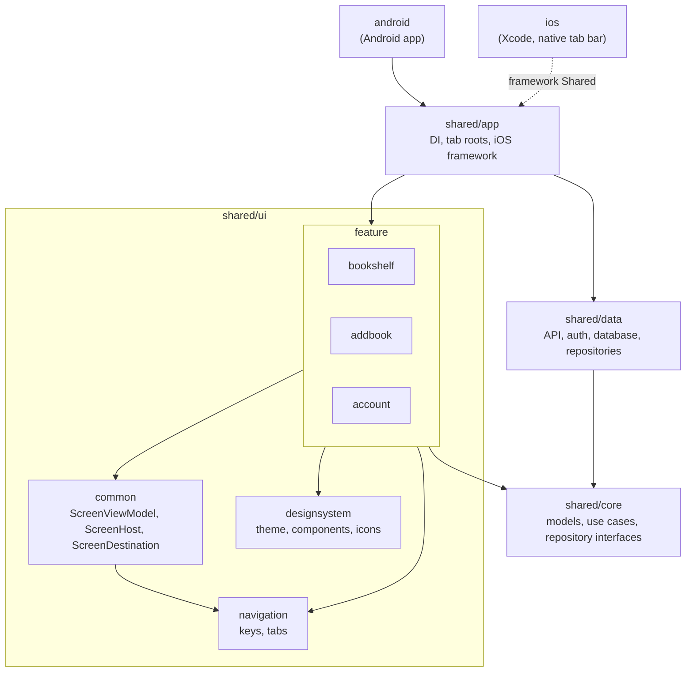
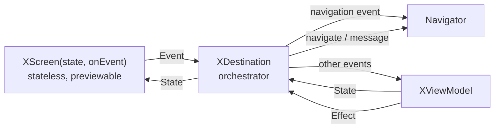

# BookTracker App – Architecture

> The mobile app for Android and iOS, built with Compose Multiplatform. It talks to the [backend](../../backend/docs/architecture.md) and to Keycloak only. Decisions and their reasons are in the [ADRs](adr/README.md).

## Overview

- **One UI for both platforms.** Screens and navigation are Compose Multiplatform code in `shared/`. Only the shells differ: a native `UITabBarController` on iOS (Liquid Glass on iOS 26+), a Material 3 navigation bar on Android ([ADR-001](adr/001-native-ios-tab-bar.md)).
- **Three tabs**, each with its own back stack: Bookshelf (your books), Add book (search, scan, add manually), Account.
- **Local-first.** The UI reads only from the local database; the backend syncs into it ([ADR-004](adr/004-local-first.md)).
- **Minimum versions:** iOS 17 and Android 14 (API 34), the versions from 2023.

| Area | Choice |
|---|---|
| Language, UI | Kotlin 2.4, Compose Multiplatform 1.12, Material 3 |
| Navigation | Navigation 3 (JetBrains multiplatform build) |
| State | Jetpack ViewModel, own `ScreenViewModel` ([ADR-003](adr/003-screen-pattern.md)) |
| Dependency injection | Koin Annotations, compiled and checked at build time by the Koin Compiler Plugin ([ADR-007](adr/007-koin-annotations.md)) |
| Network | Ktor, DTOs written by hand (comes with the first feature) |
| Local database | Room (comes with the bookshelf feature) |
| Images | Coil 3 (comes with the bookshelf feature) |
| Login | own Authorization Code + PKCE code ([ADR-005](adr/005-own-oidc-code.md)) |
| Tests | unit tests only |
| Build | Gradle with convention plugins, XcodeGen for the iOS project |

New libraries are added only after the user agreed to each one.

## Modules

Three layers, `core`, `data` and `ui`, plus the umbrella `app` ([ADR-002](adr/002-module-layout.md)):

- `ui` → `core`, `data` → `core`. `ui` never sees `data`; only `app` knows every module.
- `core` is pure Kotlin. Use cases and repository interfaces live here; `data` implements the interfaces. Gradle enforces this: the `core` convention plugin adds no Compose, Ktor or Room.
- Features never depend on each other. They navigate through the keys in `ui/navigation`.
- Konsist tests (`ArchitectureTest` in `shared/app`) check the imports: no feature imports another feature, nothing under `ui` imports `data`, `core` imports no other layer.
- ViewModels call use cases, never `data` directly.
- `app` is the only module that knows everything. iOS links only its framework `Shared`.

Package names follow the module path: `shared/ui/feature/bookshelf` is `com.sauerwein.booktracker.ui.feature.bookshelf`.

## Screen pattern

- Each screen has its own package with `XContract.kt` (state, events, effects), `XScreen.kt`, `XViewModel.kt` and `XDestination.kt`. Screen and ViewModel depend on the contract, not on each other. The screen gets only `state` and `onEvent` and works in a preview.
- The `ScreenDestination` is the orchestrator: it registers the Navigation 3 key, gets the ViewModel with `koinViewModel()` (scoped to the back stack entry), handles navigation events and effects, and forwards the other events. Koin collects all destinations.
- `ScreenHost` collects the state with the lifecycle and the effects only while the screen is STARTED.
- Navigation without logic is an event the destination handles itself. Navigation or a message after logic or async work is an `Effect`.
- A screen without state or logic has no ViewModel.

## Dependency injection

- Classes carry their lifetime (`@Singleton`, `@Factory`, `@KoinViewModel`) and get their dependencies through the constructor.
- Each Gradle module with definitions has one root module in its `.di` package, e.g. `…ui.feature.addbook.di.AddBookModule`, tagged `@Module @Configuration @ComponentScan`.
- `shared/app/.../app/di/AppKoin.kt` holds `@KoinApplication` and `initKoin`, which Android and iOS call once. The Compiler Plugin finds all root modules and checks the whole graph when `shared/app` compiles.
- The build flavor is declared at start (`koin.declare`) and received with `@Provided`.

## Navigation

- One back stack per tab (`NavBackStack`, saved through `appNavSavedStateConfiguration`; iOS needs the explicit serializers).
- `rememberTabState` (`shared/app/.../Tabs.kt`) holds a tab's back stack and its decorated entries (`rememberDecoratedNavEntries`). It must stay in composition as long as the tab lives: Navigation 3 clears the entries' ViewModels and saved state when they leave composition. `TabContent` shows the top of the stack with `NavDisplay`.
- Android: `AndroidAppRoot` keeps the state of all three tabs and the selected tab; only the selected tab is shown. Back on the root of another tab returns to the bookshelf.
- iOS: `MainTabBarController` (Swift) holds three `ComposeUIViewController`s from `IosApp`. Each is its own Compose root with its own tab state. The swipe from the left edge goes back.
- iOS needs `CADisableMinimumFrameDurationOnPhone` in the Info.plist (set in `ios/project.yml`); without it Compose aborts the app after launch.
- Known limit: Compose dialogs and sheets sit under the native iOS tab bar.

## Environments and variants

Four variants on both platforms, the dev app installs next to the prod app ([ADR-006](adr/006-build-variants.md)). `AppFlavor` (which app) and `AppEnvironment` (which backend) in `shared/data` hold the URLs, the client id and the redirect schemes. Android passes `BuildConfig.FLAVOR`, iOS the `BookTrackerFlavor` value from its build configuration.

## Strings

English and German from the start, as Compose resources (`composeResources/values` and `values-de`) in the module that uses them. The iOS tab titles are in `ios/BookTracker/Localizable.xcstrings`, the Android app name in `android/src/*/res`.

## Tests and checks

- Unit tests only, in `commonTest`; they run on the JVM as Android host tests. No UI or screenshot tests.
- Agents check UI changes with emulator and simulator screenshots, and only when asked (skill `run-app`).
- Hooks for Claude and Codex format Kotlin after each edit and build and test the changed modules at the end of a turn. See [`AGENTS.md`](../AGENTS.md).
