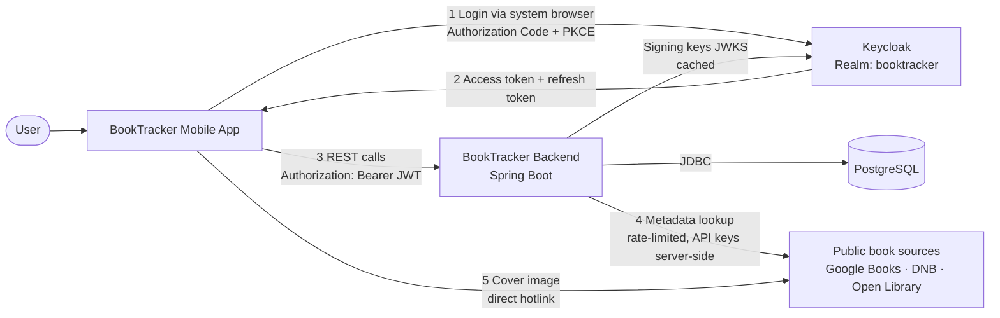
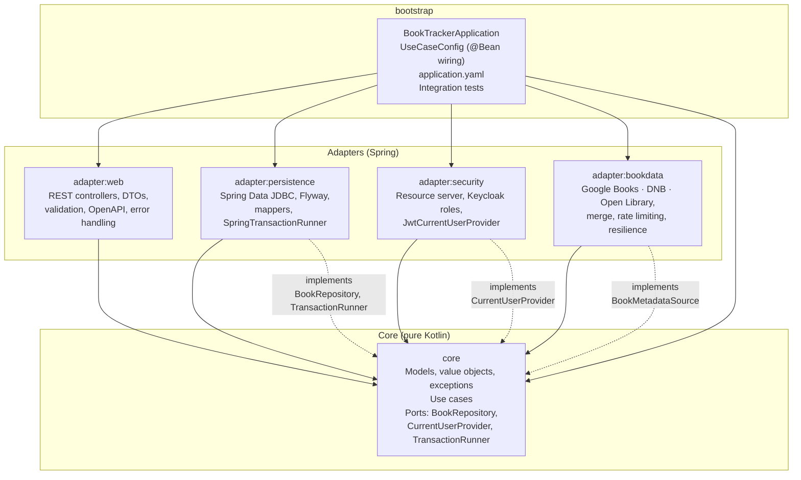
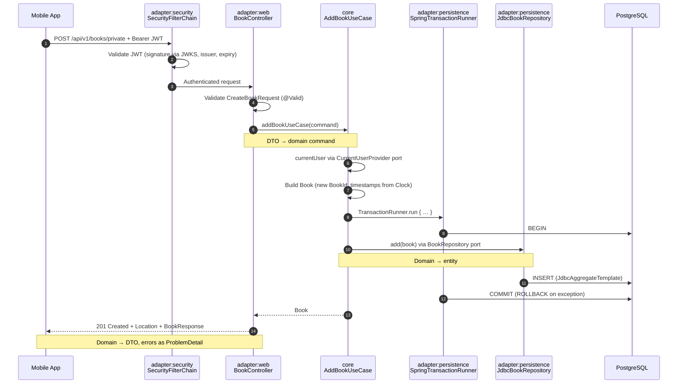
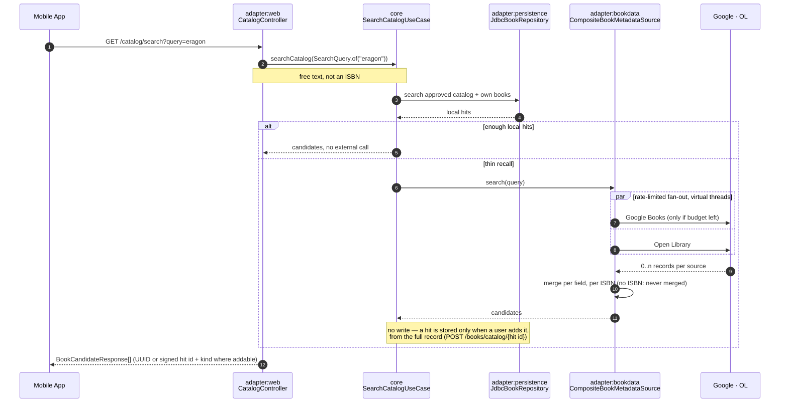

# BookTracker Backend – Architecture

> Status: Draft · Last updated: 2026-10-03

## 1. Context & Goals

The BookTracker backend is a classic CRUD backend for the **BookTracker mobile app**. It provides a REST API, stores data in PostgreSQL and delegates authentication to a self-hosted **Keycloak**.

**Goals**
- Clear boundaries between business logic and technology, **enforced by the build**
- Little boilerplate for simple CRUD cases, while leaving room for growing business logic
- Best-practice auth for mobile apps (OAuth2 Authorization Code + PKCE)
- Reproducible local development and tests against real infrastructure

**Tech stack**

| Area | Technology |
|---|---|
| Language / runtime | Kotlin 2.3, Java 25 |
| Framework | Spring Boot 4.1 (Spring MVC) |
| Build | Gradle (Kotlin DSL), multi-module, version catalog, convention plugins |
| Persistence | PostgreSQL, Spring Data JDBC, Flyway |
| Auth | Keycloak (OIDC), Spring Security OAuth2 Resource Server |
| External book data | Google Books API, DNB SRU, Open Library (ADR-007) |
| Resilience | Resilience4j (rate limiter, circuit breaker); timeouts on the JDK `HttpClient` |
| API docs | springdoc-openapi (OpenAPI 3, Swagger UI) |
| Tests | JUnit 5, kotlin-test — unit tests only |
| Local infrastructure | Docker Compose (`spring-boot-docker-compose`) |

## 2. System Context



- The app opens the Keycloak login in the **system browser** (ASWebAuthenticationSession / Custom Tabs). The backend never sees a password.
- The backend is a **pure resource server**: it validates signature, issuer and expiry of the JWTs and reads the user ID (`sub`) and roles from them.
- User accounts (registration, password reset, MFA) are managed by Keycloak. The backend references users exclusively by their `sub` ID.
- Book metadata comes from public sources at request time. The backend is the **only** component that talks to them, so API keys, rate limits, normalisation and caching live in one place — and the sources see the server's IP, never the user's. Cover images are the deliberate exception: the app loads them straight from the source (ADR-004), which keeps image traffic off the backend entirely.

## 3. Module Structure

The backend follows a **hexagonal architecture (ports & adapters)** with a **pure Kotlin core**. Each part is its own Gradle module; within the modules, code is split **by feature** (`book`, `shelf`, …).



Solid arrows are Gradle dependencies; dashed arrows show which adapter implements which port. All dependencies point **inwards**: the core knows no adapter, and adapters don't know each other.

### 3.1 Modules at a Glance

| Module | Responsibility | May depend on | Key dependencies |
|---|---|---|---|
| `core` | Domain models, business rules, use cases, all ports (repositories, `CurrentUserProvider`, `TransactionRunner`), domain exceptions | – | Kotlin stdlib only (**no Spring**) |
| `:adapter:web` | HTTP API: controllers, request/response DTOs, validation, OpenAPI, errors → ProblemDetail | `core` | `starter-webmvc`, `jackson-module-kotlin` (Jackson 3), `starter-validation`, `springdoc-openapi-starter-webmvc-ui` |
| `:adapter:persistence` | Implementation of the repository ports and `TransactionRunner`, DB entities, migrations | `core` | `starter-data-jdbc`, `starter-flyway`, `flyway-database-postgresql`, `postgresql` (runtime) |
| `:adapter:security` | `SecurityFilterChain`, JWT → roles, `CurrentUserProvider` | `core` | `starter-security-oauth2-resource-server` |
| `:adapter:bookdata` | One client per public book source, the provider registry (capabilities, order, enablement from config), normalisation and field-level merge *(planned)*, rate limiting and circuit breaking | `core` | `spring-web` (`RestClient`), `resilience4j-ratelimiter`/`-circuitbreaker`/`-micrometer`, `jackson-module-kotlin`, `micrometer-core` |
| `bootstrap` | Assembly: main class, use case wiring, configuration | all | `spring-boot-starter`, `starter-actuator`, `spring-boot-docker-compose` (dev only) |

### 3.2 Architecture Rules

1. **Only `implementation(project(...))`, never `api(...)`.** Dependencies do not leak transitively, e.g. `:adapter:web` cannot import persistence classes. Violations are **compile errors**.
2. **`core` is framework-free.** No Spring, JDBC or Jackson in `core`, not even annotations. Enforced by the build: `core` has no Spring on its classpath.
3. **Ports live in `core`, implementations in the adapters.** This covers repositories as well as technical ports like `CurrentUserProvider` and `TransactionRunner`.
4. **Separate models per layer.** Web DTOs ↔ domain model ↔ persistence entity are translated via mappers (Kotlin extension functions). This keeps the API contract, domain model and DB schema independently changeable.
5. **One class per use case, no interface in front.** E.g. `AddBookUseCase`, `UpdateProgressUseCase`. Tests fake the ports, not the use cases. An interface is only introduced once there are multiple implementations.
6. **Controllers only talk to use cases**, never directly to ports. Every use case enforces visibility itself, so the check cannot be skipped: a user may change only their own rows, and may read their own plus the public ones (`owner_id IS NULL`).
7. **Transactions via the `TransactionRunner` port.** Use cases wrap their work in `tx.run { … }`; the implementation in `:adapter:persistence` uses Spring's `TransactionTemplate`. No `@Transactional` in `core` or on controllers.
8. **Use cases are wired in `bootstrap`.** `UseCaseConfig` registers each use case as a `@Bean`. Adapters use regular Spring stereotypes (`@RestController`, `@Component`, …).
9. **Logic starts in the use case.** A rule moves into the domain model once it is clearly a business rule (e.g. "progress must not exceed the page count"). Models may stay plain `data class`es until then.
10. **No security knowledge in the web adapter.** The current user is provided by the `CurrentUserProvider` port, not by `@AuthenticationPrincipal`.

## 4. Request Flow

Example: `POST /api/v1/books/private` (create a private book). `WebConfig` adds the `/api/v1` prefix to the project's own `@RestController`s; springdoc's endpoints are excluded by package and stay at the root.

The transaction step is part of the target design and not implemented yet.



## 5. Package Convention & Example Feature

Packages follow the pattern `com.sauerwein.booktracker.<module>.<feature>` (e.g. `core.book`, `adapter.web.book`). The main class lives in `com.sauerwein.booktracker` so that component scanning and JDBC repository scanning cover all modules.

Within a feature package, the code is grouped further into sub-packages: `models`, `usecases` and, where a feature has its own errors, `exception` in `core` (e.g. `core.book.models`, `core.book.usecases`, `core.book.exception`), `dtos` in `:adapter:web` (e.g. `adapter.web.book.dtos`). Ports stay directly in the feature package (`core.book.BookRepository`), and **only ports**: plain data such as `SourceDescriptor` is a model, and logic built on the ports is a use case — including the ones only other use cases call (`ResolveIsbnUseCase`, `UpsertCatalogEntryUseCase`). Cross-feature code lives in `shared` (core) or `common` (adapters), grouped by concern (`config`, `exception`).

Files marked *(planned)* don't exist yet.

```
backend/
├─ build-logic/                               # Convention plugins
├─ gradle/libs.versions.toml                  # Central versions
├─ core/src/main/kotlin/com/sauerwein/booktracker/core/
│  ├─ shared/
│  │  ├─ TransactionRunner.kt                 # Port (planned)
│  │  └─ exception/                           # NotFoundException, ValidationException, ConflictException
│  ├─ user/
│  │  ├─ CurrentUserProvider.kt               # Port, current user of the request
│  │  └─ UserId.kt                            # Value object, Keycloak sub
│  └─ book/
│     ├─ BookRepository.kt                    # Outbound port (interface)
│     ├─ BookMetadataSource.kt                # Outbound port, public book sources
│     ├─ exception/
│     │  └─ SourceUnavailableException.kt     # A source could not answer → 503
│     ├─ models/
│     │  ├─ Book.kt                           # Domain model + BookId value object
│     │  ├─ BookCandidate.kt                  # Unsaved search hit + source provenance
│     │  ├─ CatalogMapping.kt                 # Licence rule, candidate ↔ catalog row
│     │  ├─ Author.kt                         # Name + optional SourceRef
│     │  ├─ SearchQuery.kt                    # Classifies ISBN vs. free text
│     │  ├─ SourceDescriptor.kt               # Provider id, capabilities, licence
│     │  ├─ SourceId.kt, SourceRecordId.kt    # Value classes for provider and record keys
│     │  ├─ SourceRef.kt                      # A key together with its issuing source
│     │  └─ Isbn.kt                           # Value object, always a valid ISBN-13
│     └─ usecases/
│        ├─ AddBookUseCase.kt                 # Use case + AddBookCommand
│        ├─ GetBookUseCase.kt
│        ├─ GetBooksUseCase.kt
│        ├─ SearchCatalogUseCase.kt           # Catalog first, external on thin recall
│        ├─ FindBookByIsbnUseCase.kt          # Scan flow, exact lookup
│        ├─ ResolveIsbnUseCase.kt             # Catalog first, then the sources, then store
│        └─ StoreCatalogEntryUseCase.kt       # Grows the catalog, licence permitting; never refreshes
├─ adapter/web/src/main/kotlin/com/sauerwein/booktracker/adapter/web/
│  ├─ common/
│  │  ├─ config/
│  │  │  ├─ WebConfig.kt                      # /api/v1 prefix for own @RestControllers
│  │  │  └─ OpenApiConfig.kt                  # OpenAPI title and version
│  │  └─ exception/
│  │     ├─ GlobalExceptionHandler.kt         # expected errors → ProblemDetail
│  │     ├─ FallbackExceptionHandler.kt       # anything unhandled → 500, logged
│  │     └─ ValidationError.kt                # field, code, message per failed field
│  ├─ book/
│  │  ├─ BookController.kt
│  │  ├─ BookWebMapper.kt
│  │  └─ dtos/
│  │     ├─ CreateBookRequest.kt
│  │     └─ BookResponse.kt
│  └─ catalog/                                # Discovery, separate from the library (planned)
│     ├─ CatalogController.kt                 # /catalog/search, /catalog/isbn/{isbn}
│     ├─ CatalogWebMapper.kt
│     └─ dtos/BookCandidateResponse.kt        # Opaque id + kind; no provenance
├─ adapter/persistence/src/main/
│  ├─ kotlin/com/sauerwein/booktracker/adapter/persistence/
│  │  ├─ common/SpringTransactionRunner.kt    # implements core TransactionRunner (planned)
│  │  └─ book/
│  │     ├─ BookEntity.kt                     # @Table data class
│  │     ├─ BookQueries.kt                    # Spring Data Repository, visibility-scoped reads
│  │     ├─ JdbcBookRepository.kt             # implements core BookRepository
│  │     └─ BookPersistenceMapper.kt
│  └─ resources/db/migration/
│     ├─ V1__init.sql
│     ├─ V2__book.sql
│     ├─ V3__book_owner.sql
│     ├─ V4__book_source.sql                  # Provenance, review_state, book_author
│     ├─ V5__user_book.sql
│     └─ V6__book_language.sql                # The edition's language (BCP 47 subtag)
├─ adapter/bookdata/src/main/kotlin/com/sauerwein/booktracker/adapter/bookdata/
│  ├─ CompositeBookMetadataSource.kt          # Parallel fan-out by descriptor, merge per ISBN, outage vs. miss
│  ├─ BookCandidateMerge.kt                   # First non-null per field over the configured order
│  ├─ MergePrecedence.kt                      # The field orders, keyed by language
│  ├─ BookDataConfig.kt                       # The one BookMetadataSource bean (the composite)
│  ├─ BookDataProperties.kt                   # One uniform block per provider, search order, precedence
│  ├─ BookSourceRegistration.kt               # How a provider joins the composite
│  ├─ ThrottledRestClient.kt                  # RestClient with the per-second limiter on the wire
│  ├─ googlebooks/GoogleBooksClient.kt        # Search only; + DTOs, mapper, DailyQuotaGuard, config
│  ├─ dnb/DnbSruClient.kt                     # ISBN lookup only; + hardened MARC21-XML parser, mapper, config
│  ├─ openlibrary/OpenLibraryClient.kt        # + DTOs, mapper, config
│  └─ resilience/                             # Circuit breaker + metrics wrapper, rate limiter, exceptions
├─ adapter/security/src/main/kotlin/com/sauerwein/booktracker/adapter/security/
│  ├─ SecurityConfig.kt                       # SecurityFilterChain
│  ├─ KeycloakRoleConverter.kt                # realm_access.roles → ROLE_*
│  └─ JwtCurrentUserProvider.kt
├─ bootstrap/src/
│  ├─ main/kotlin/com/sauerwein/booktracker/
│  │  ├─ BookTrackerApplication.kt
│  │  └─ config/UseCaseConfig.kt              # @Bean per use case, Clock bean
│  └─ main/resources/application.yaml
├─ compose.yaml                               # Local dev: Postgres + Keycloak
├─ compose.prod.yaml                          # Production: app + Postgres (Keycloak runs separately)
└─ keycloak/realm-booktracker.json            # Realm import for local development
```

Wiring a use case in `bootstrap`:

```kotlin
@Configuration
class UseCaseConfig {
    @Bean
    fun clock(): Clock = Clock.systemUTC()

    @Bean
    fun addBookUseCase(bookRepository: BookRepository, clock: Clock) = AddBookUseCase(
        bookRepository = bookRepository,
        clock = clock
    )
}
```

Once they exist, `CurrentUserProvider` and `TransactionRunner` are passed in the same way.

## 6. Build Setup

- `settings.gradle.kts` includes `build-logic` via `includeBuild` and registers all modules. Adapters are nested under `adapter/` (`include("adapter:web")` → project `:adapter:web` in `adapter/web/`); the parent `:adapter` is an empty grouping project without a build script. The foojay resolver provisions the Java toolchain automatically.
- `gradle.properties` holds `group`/`version` for all projects and enables parallel builds, the build cache and the configuration cache.
- Convention plugins in `build-logic` keep the module build scripts short:

| Plugin | Contents | Used by |
|---|---|---|
| `booktracker.kotlin-library` | Kotlin JVM, Java toolchain from the catalog, compiler args (`-Xjsr305=strict`, `-Xannotation-default-target=param-property`), Kotlin BOM, JUnit Platform | `core` |
| `booktracker.spring-library` | + `kotlin-spring`, Spring Boot BOM as `platform(...)`, `kotlin-reflect` | adapters |
| `booktracker.spring-boot-app` | + Spring Boot plugin (executable jar, `bootRun`) | `bootstrap` |

- Versions live exclusively in `gradle/libs.versions.toml`. The Spring Boot BOM is included as a Gradle platform; the `io.spring.dependency-management` plugin is dropped.

## 7. Cross-Cutting Concerns

### Security
- Stateless, no session, CSRF disabled (pure token API).
- Public: `/v3/api-docs/**`, `/swagger-ui/**`, `/actuator/health/**`. Everything else requires a valid JWT — including `/actuator/metrics`. Only `health` and `metrics` are exposed.
- `issuer-uri`: `http://localhost:8180/realms/booktracker` (local), overridable via `BOOKTRACKER_ISSUER_URI`. JWKS keys are loaded lazily on the first token and cached.
- The issuer URL must be a **stable DNS name** per environment. It is part of every token (`iss`), of the client's redirect URIs and of the Swagger UI configuration, so changing it later invalidates all issued tokens.
- Roles: Keycloak claim `realm_access.roles` → Spring authorities `ROLE_<name>`.
- Keycloak client `booktracker-app`: public client, standard flow + PKCE (S256), redirect URI via app scheme.

### Validation & Error Handling
- Bean Validation on request DTOs (`@field:NotBlank`, `@field:Positive`, …) and `@Valid` in the controller. Failed fields are returned in an `errors` list (`field`, `code`, `message`); clients branch on `code`, since `message` is localized by Hibernate Validator. The server locale is fixed to `en` so messages don't depend on the machine.
- Business invariants are checked by the domain model itself. Invalid input throws `ValidationException` (`field`, `code`) and becomes a 400 in the same shape as a Bean Validation error; `require(...)` stays for real invariants, whose violation is a bug and ends as a 500.
- Two `@RestControllerAdvice`s translate errors consistently into **ProblemDetail (RFC 9457)**: `GlobalExceptionHandler` with the highest precedence (ahead of Spring Boot's own `ProblemDetailsExceptionHandler`, which is registered with `@Order(0)`), and `FallbackExceptionHandler` with the lowest, so a catch-all doesn't shadow the more specific handlers.

| Error | HTTP status |
|---|---|
| Validation error | 400 |
| `NotFoundException` | 404 |
| Conflict / duplicate | 409 |
| `SourceUnavailableException` (book source down, throttled or circuit open) | 503, `code: SourceUnavailable`, fixed detail without the source's name (it is logged instead) |
| Unexpected error | 500 (without internal details) |

### API Documentation
- springdoc generates `/v3/api-docs` and the Swagger UI. An OAuth2 security scheme against Keycloak is configured so the Swagger UI can send authenticated requests.
- The OpenAPI spec can serve as the basis for client generation in the mobile app.

### Database & Migrations
- The schema is managed **exclusively via Flyway** (`adapter/persistence/src/main/resources/db/migration`), no automatic schema generation.
- Naming scheme: `V<n>__<description>.sql`. Migrations that have already been applied are never modified.
- User ownership via a nullable `owner_id` column (Keycloak `sub`, UUID, added in `V3__book_owner.sql`): set means private to that user, `NULL` means a public catalog entry. No user table, and no foreign key.
- Because of that missing foreign key, Keycloak's user store is as critical as this database: if a realm is recreated, every `sub` changes and every row is orphaned. A production Keycloak therefore needs its own persistent database and backups.
- Edition granularity (ADR-008): a row is one edition, so several rows per work are normal and expected. A nullable `work_key` (Open Library work key where known) rides along in the same migration, purely to make later grouping possible without touching accumulated rows.
- The edition's language (`V6__book_language.sql`, 9.9): a BCP 47 primary language subtag (`de`, `en`; three letters only where no two-letter code exists), normalised by `Language` in `core` whatever spelling a source or a user sends (`ger`, `deu`, `de-AT` → `de`). `NULL` where unknown, and for every row written before 9.9 — no backfill. A `CHECK` pins the format, not the vocabulary.
- Catalog provenance (`V4__book_source.sql`): `source`, `source_id` (that system's own key — a DNB IDN like `1055026991`, an Open Library edition key like `OL7353617M`, a Google volume id), `source_fetched_at`, and `review_state`. A unique index on `(source, source_id) WHERE owner_id IS NULL` keeps the catalog free of duplicates when two users resolve the same book, which ISBN alone cannot do — some records carry none.
- **`source` is an open vocabulary, not a closed enum:** plain `TEXT` with no constraint on the value set. Provider ids are lowercase, stable and never renamed — `manual`, `dnb`, `open_library`, `google_books`, and whatever comes later. The reason is that **the data outlives the providers**: a row written from DNB stays `source = 'dnb'` for as long as it exists, years after the client might be deleted. The column records history; which providers are *active* is configuration (see External Book Data below), not schema. A `CHECK` listing the known providers would turn every new provider into a migration and would make retiring one impossible.
- Only data we are licensed to store may enter the **public** catalog, and that is written as an **allowlist**, so it fails closed:
  ```sql
  CHECK (owner_id IS NOT NULL OR source IN ('manual', 'dnb', 'open_library'))
  ```
  A denylist (`source <> 'google_books'`) expresses the same rule but fails in the opposite direction: add a provider and forget the rule, and its records flow silently into a table every user reads. With the allowlist, the same oversight rejects the first insert — loudly, during development, at the moment someone would be reading that provider's licence anyway. A new provider is therefore search-only until it is deliberately promoted — and promoting one *does* take a migration to extend the constraint. That asymmetry is the point: adding a provider is free, while granting it space in the catalog every user reads is a reviewed act with a paper trail. Same instinct as ADR-006 deleting `findAll()` outright and rule 6 putting the visibility check where it cannot be skipped: shape it so the mistake is impossible, not merely discouraged.
- The authority for that decision is the provider's `SourceDescriptor` (see below), checked in the use case so it is unit-testable; the `CHECK` is the backstop that catches a code path nobody thought of.
- Catalog reads filter `review_state = 'APPROVED'` from that migration on, even though everything is inserted as `APPROVED` today. Writes respect it too: storing a catalog record inserts it or, if it is already stored, hands back the approved row as it is (`ON CONFLICT … DO NOTHING`, then an approved-only read). Since 9.9 a stored row is **never refreshed** by a lookup (Q16), so a scan or an add never overwrites a review decision — nor a fuller earlier merge —, and a record held by a non-approved row is neither handed out by id nor linked to anyone. Introducing a review workflow later is then a changed default plus an admin endpoint — not an audit of every read path. The name is deliberately not `status`: ADR-006 rejected a single `status` field for the user's *relationship* to a book, and two adjacent columns of that name would confuse both.

### External Book Data

Metadata comes from three public sources at request time, behind the single port `BookMetadataSource` (ADR-007). `:adapter:bookdata` holds one client per source plus the merge and all resilience; `core` and the app see one normalised `BookCandidate` shape.

**Division of labour: Google finds the book, DNB and Open Library describe the one we keep.** Recall and field accuracy are different qualities. Google's free-text matching is far ahead — it survives typos and partial titles — while its field data is largely derived from scans and publisher feeds, so page counts and dates are the weak spots. A national library record describes a specific physical edition.

Measured, not assumed — each source is strong in exactly one column and none in both:

| | Free-text search | ISBN lookup |
|---|---|---|
| **Google Books** | ✅ excellent — 161 hits for `eragon paolini`, 9 of the top 10 German editions | ⚠ works again since the 2026-10 outage was fixed, but not used for lookup yet, see below |
| **DNB** | ❌ **no relevance ranking at all** | ✅ complete and authoritative for German imprints |
| **Open Library** | usable | ⚠ edition-dependent |

**DNB cannot do free-text search, and this is structural.** SRU rejects `sortKeys` outright (`info:srw/diagnostic/1/8 Unsupported parameter`), so results come back **newest-first, never by relevance**. For `PER=Herrndorf and TIT=Tschick` — 98 records — the top three were a 2026 audiobook, a school edition, and the *Georgian* translation. Its descriptor therefore declares `supportsFreeTextSearch = false`; it is a lookup and field authority, not a search provider.

**The decisive axis for ISBN lookup is the edition, not the language.** This is easy to get wrong: a single failed lookup looks like a coverage gap. For `9783570402931` (Eragon, cbj, 22nd printing 2014) Open Library returns nothing. But it does carry other German editions of the same work (it resolves `9783641023027`). So it is not "thin on German"; it simply indexes *different printings*.

Correction (2026-11-16): this paragraph originally said Google had no record for `9783570402931` either. That lookup ran during Google's `isbn:` outage (below), so the empty answer was the bug, not missing data. With the operator working again, Google returns it: *Eragon 01. Das Vermächtnis der Drachenreiter*, 733 pages, both ISBN forms, no publisher.

That matters because a barcode scan yields the ISBN of **one specific printing**. The consequences:

- Fan-out across sources on ISBN lookup is not a nicety, it is how a hit happens at all. A single-source lookup fails often.
- **Every ISBN provider is asked, in parallel, and what they know is merged** (9.9 Q1). A scan therefore costs one request per provider (Open Library: two, edition and author), but the latency is the slowest provider's, not the sum.
- **DNB leads German-language editions**, because legal deposit means it receives essentially every German-language printing, while a commercial index carries what it has digitised or been fed. That is the real argument — not a coverage deficiency elsewhere. Since 9.9 this is a field precedence keyed by the book's language (`de`), not an ISBN order: 9.8 keyed the order by ISBN group (`978-3`) as a stand-in until the merge existed.
- **For every other language DNB comes last.** It is not only German: it collects translations of German works, German-language books from foreign publishers, and more — on 2026-11-17 it had the Slovak *Tschick* (`9788082035097`) and even *Code Complete* (`9780735619678`). As the last entry it only fills what the others lack, and answers alone where nobody else knows the ISBN.
- Reverse the order for free-text search: Google first, DNB not at all.

**Google is a search-only provider, and stays one.** Its descriptor declares `supportsIsbnLookup = false` and the scan flow never calls it — which also means the most important path in the MVP consumes none of the 1,000/day budget. This started as a workaround for a Google outage, which has since been fixed; it is now a decision (9.7 D7): Google only helps find a book, and its data is never stored, not even in a private book (D6), so a Google lookup could not even pre-fill a form.

**Status (2026-11-16): the operators work again.** Measured with our key, `country=DE`, every call `200`: `intitle:eragon` → 125 hits (was 0), `inauthor:paolini` → 127, `isbn:0735619670` → exactly 1, *Code Complete* (the control below). ISBN-10 and ISBN-13 forms return the same volume. Re-check before relying on it. Cheap test: `q=intitle:eragon` must return hits.

**What a working `isbn:` returns: facts to know before using it for lookup** (2026-11-16):

- **A correct hit does not always carry the ISBN.** `isbn:0735619670` returns *Code Complete* as a library-scan record whose only identifier is `OTHER:UCSC:…`. Whether the result really belongs to the ISBN cannot be checked from the response.
- **One ISBN can return several volumes of the same edition.** `isbn:9780375826689` returns a library scan (552 pages, no ISBN in the record) and a publisher record (ISBN-10 + ISBN-13, `pageCount: 0`). A `0` page count means "unknown", not zero pages.

**History: the 2026-10 outage (Google issue `569300353`).** From **3 October 2026**, every field-restricted operator — `intitle:`, `inauthor:` and `isbn:` — returned `totalItems: 0` while plain queries worked normally. It was reported by several independent people on Google's developer forum and tracked as issue `569300353`. Last seen broken on 17 October 2026, working again on 16 November 2026.

Measured here on two days during the outage, the second with the service entirely calm (no `503`, and `eragon paolini` returning an identical 161 hits both times): `isbn:` gave 0 for `0735619670` — a control documented in a widely-cited Stack Overflow answer as returning exactly one hit — for `9783641023027`, an ISBN *Google itself* reports for a German Eragon edition, and for `9780375826689`. Querying the bare digits as free text returns 0 as well.

Ruled out, so nobody repeats the experiments: **not the syntax** (`?q=isbn:<isbn>` is what Google's documentation, community examples and third-party clients all build), **not the operator's case**, **not the `country` parameter** (queries without it return 0 just the same), **not a cold project**, **not our key or project** (the same breakage is reported globally), and **not coverage** (Google returns these very ISBNs itself in `industryIdentifiers`).

Two traps, still valid with the operator working:

- **The operator is case-sensitive, and the uppercase form silently degrades to free text.** During the outage `ISBN:0735619670` returned 8 hits where `isbn:0735619670` returned 0. On 2026-11-16 it still returns 10 unrelated books (top: *Programming in Python 3*), and none of the first 5 carries the ISBN. Those are fuzzy matches, *not* an exact ISBN match — using them for a scanned barcode would attach the wrong book to the wrong ISBN. Plausible-looking wrong results are worse than zero honest ones.
- **Omitting the colon is not a syntax error, just a different query.** `q=isbn0735619670` runs a free-text search.

**The reasons for keeping Google out of the lookup did not depend on the outage.** DNB and Open Library cover ISBN lookup between them, and a Google hit would spend one of 1,000 daily calls on the MVP's most frequent path. The one argument in favour — a scan no CC0 source knows could pre-fill the private-book form — fell with D6: Google data does not go into private books either. Flipping the flag stays one value in the descriptor, should that ever change.

Merge happens **field by field** — no single source reliably has everything — as **first non-null wins over a configured order** (`BookCandidateMerge`, 9.9). It only ever merges records of **one edition**: the ISBN lookup's answers for the scanned ISBN, or search hits with the same ISBN-13. Hits without an ISBN are never merged (9.9 Q5), and editions of one work stay apart (ADR-008).

| Field | Order (language `de`) | Order (every other language, or unknown) |
|---|---|---|
| title, authors, publisher, year, pageCount, work key | `dnb` → `google_books` → `open_library` | `google_books` → `open_library` → `dnb` |
| coverUrl | `google_books` → `open_library` | `open_library` → `google_books` |
| language (decided first, the same for every book) | `dnb` → `open_library` → `google_books` | as before |
| ISBN | the one asked for, or shared by the merged hits | as before |

In practice Google and DNB never meet: Google does no ISBN lookup and DNB no search. So a scan merges DNB and Open Library, a search Google and Open Library.

- **The language is decided first**, over its own list, because the order of every other field depends on it. Each mapper reads it from its source (Google `language`, Open Library `languages` / `editions.language` — never the work-level list, which names every translation —, DNB `041$a`, else `008/35-37`) and `Language` normalises it.
- **Authors are one field**: the first non-empty list wins whole. Two lists are never combined — the same person spelled twice would appear twice.
- **The record is named after the one whose title it carries**: its `source` and `source_id` become the row's identity. Other providers only fill fields.
- **A merged record is only as storable as its least storable contribution** (9.9 I12): it may enter the catalog only if every record that supplied a field may. So Google data cannot ride into a stored row under a CC0 provider's identity — not today, and not if a provider's capabilities change later.
- No condition on "did DNB have it" is needed: a provider that returns no record contributes nothing, so the next one in the order wins automatically.
- ⚠ **A provider that fails during a scan only shortens the record — for good.** The catalog answers that ISBN from then on, so the missing fields are not merged in later. Seen on 2026-11-17: Open Library's TLS handshake took ~5 s against a 1 s connect timeout, and a German scan was stored from DNB alone, without a cover. **Our own throttle does the same under load** (9.9 review F2): every catalog miss and every added hit now also asks Open Library (edition plus author, 2–3 requests at 1 req/s), and a request that waits longer than 5 s for a permit counts as failed — a burst of scans stores the later ones without Open Library's fields. A stored row is never refreshed by a later lookup (9.9 Q16), so a short row stays short — but a full row can never be made shorter either. One more cost of that: a record listing several ISBNs (an Open Library edition, hardcover and paperback) keeps the first one stored, so a scan of the other one misses the catalog and asks the sources again each time (review F16).
- ⚠ **A provider record without an author contributes nothing**, because every mapper drops such records (a book needs an author). Open Library editions often list their authors only on the work (*Harry Potter und der Stein der Weisen*, `9783551354013`): its cover then never reaches the merge.

**Providers are pluggable by design: addable, removable, reorderable without touching the orchestration.** Three properties make that true, and all three are needed — the first alone only makes *adding* cheap.

1. **Each provider declares itself.** A `SourceDescriptor` (in `core`, so it is plain data and the licence rule stays unit-testable) carries the stable `id`, what the provider can do — ISBN lookup, free-text search, covers — its scope (language, publisher), and whether its licence permits storing records in the public catalog. `CompositeBookMetadataSource` reads the descriptors and skips providers that cannot serve a given query instead of calling them and discarding the answer. Without this the composite has to *know* that DNB has no covers and that a publisher API only holds its own titles, and every new provider means editing the fan-out — at which point "easy to add" is no longer true.
2. **Order, precedence and enablement are configuration.** One uniform block per provider, so adding one is filling in a block and reordering is a restart:

```yaml
booktracker.bookdata:
  order:
    search: [google_books, open_library]           # the order search hits are listed in
  precedence:                                      # which value wins a field (MergePrecedence)
    language: [dnb, open_library, google_books]
    default:  { fields: [google_books, open_library, dnb], cover: [open_library, google_books] }
    by-language:
      de:     { fields: [dnb, google_books, open_library], cover: [google_books, open_library] }
  open-library: { enabled: true, base-url: https://openlibrary.org, rate-per-second: 1, connect-timeout: 5s, read-timeout: 10s }
  google-books: { enabled: true, base-url: https://www.googleapis.com, api-key: …, country: DE }
  dnb:          { enabled: true, base-url: https://services.dnb.de, rate-per-second: 1, read-timeout: 3s }
```

A field's order is looked up as: the language's own list for that field, the language's `fields`, then the same two in `default`; per-field lists exist for `title`, `authors`, `publisher`, `publication-year`, `page-count`, `cover` and `work-key`. Providers not listed come last, by id. A language key is normalised like any language and fails startup if it is none; an id that matches no running provider is warned about. Which providers are asked never depends on the precedence — every provider that can serve the query is.

3. **Wiring is a list of beans.** Each provider's config registers a `BookSourceRegistration`, and the composite collects them — so the composite is the only `BookMetadataSource` bean, with no `@Primary` and no risk of injecting itself. `@ConditionalOnProperty` on each provider config makes `enabled: false` a real removal. That matters operationally, not just architecturally: a provider returning garbage can be switched off in production without a deploy. Naming the Resilience4j instances and Micrometer tags after the provider id means limits, circuit breakers and metrics come for free with the block rather than being wired per provider.

Removing a provider is therefore `enabled: false`, deleting its package, and dropping it from the precedence lists. What it is *not* is a data migration: existing rows keep `source = 'dnb'` and stay valid, because `source` is an open vocabulary. Adding a *search-only* provider needs no migration either; only promoting one to the public catalog does, by extending the allowlist `CHECK`.

**What this deliberately is not: a plugin system.** No SPI, no dynamic loading, no provider registry service. Three to five providers in one codebase is a list of beans and a config block; an extension framework here would be permanent complexity bought against a need that never arrives.

**What stays manual, whatever the design.** Worth stating so the next person is not surprised:

- One mapper per provider is irreducible — JSON, MARC21-XML and whatever the next one speaks are genuinely different. That is the right amount of work, not accidental complexity.
- **Licence review is a human step, every single time**, and cannot be inferred from a response. The allowlist does not remove it; it makes forgetting it fail loudly instead of silently.
- Field-quality ordering is empirical. Config makes *changing* the order cheap; it does not tell you what the order should be. That knowledge comes from looking at records.
- Fusing relevance-ranked results degrades as providers multiply. With 2–4 sources and ISBN-based dedupe it is fine; at eight it becomes a ranking problem in its own right. That is the scaling limit of this design.

**Discovery is separate from the user's books.** `GET /api/v1/books` lists the user's own books; discovery lives under `/api/v1/catalog`. Different latency, different caching, different response shape — a hit is a candidate, not yet one of the user's books, so it gets its own DTO. Every hit the app may add carries an opaque `id` and `kind: CATALOG`; the caller's own books come back as `PRIVATE`. The `id` of a stored book is its UUID; a hit not stored yet gets a **signed hit id** (`h2.<payload>.<tag>`, HMAC-SHA256 over a typed payload, `CatalogHitIds`): `i:<isbn>:<source>:<record>` for a hit that may enter the catalog by itself — its ISBN, plus its own record as the fallback —, `i:<isbn>` for any other hit, e.g. one whose data may not be stored (Google) or that was merged with such data. So the app hands back one kind of id and cannot forge or alter it. (The former `r:<source>:<record>` kind no longer decodes since 9.9.) The id is signed, not encrypted: it is opaque to the app, not secret. **Provenance never leaves the backend**: responses carry no `source`/`sourceId`, and errors do not name a provider either, so the app cannot start to depend on one. A hit without an id cannot be added, only copied into a private book; a hit **with** an id is never copied (9.7 D6). Google hits without an ISBN are dropped, so every Google hit has an id (D8), and results are deduplicated by ISBN — external hits arrive merged per ISBN, a stored catalog row is shown as stored and hides the external hits with its ISBN, the caller's private books hide nothing (D10). Every result carries the edition's `language`, `null` where no source knows it.

| Endpoint | Purpose | Miss behaviour |
|---|---|---|
| `GET /api/v1/catalog/search?query=` | Free-text **or** ISBN; the backend classifies | empty list; **503** only if there are no local hits, nothing was found and a source failed (9.7 D2, D4) |
| `GET /api/v1/catalog/isbn/{isbn}` | Scan flow, exact lookup | **404** → the app opens the manual form |
| `POST /api/v1/books/catalog/{id}` | Add catalog book `{id}` (UUID or signed hit id, as returned) to my books — a link, never a copy. A hit not stored yet is resolved by its ISBN like a scan, and only the merged CC0 record is stored; the hit's own full record is the fallback when its ISBN resolves to nothing or a provider is down while resolving it | **404** for anything but an approved catalog book or a valid hit id, and for an ISBN no CC0 source knows (the app then opens an **empty** form, 9.7 D9); **409** if already added; **503** if the source is down while adding a hit |
| `POST /api/v1/books/private` | Create a private book from fields (manual entry, or a catalog book the user wants to change, copied by the app) | — |

- **The backend detects ISBNs, not the app.** `SearchQuery.of(raw)` in `core` returns either an ISBN query or free text, so a user pasting an ISBN into the search box just works and the rule lives in one place. It already needs the ISBN-10 → ISBN-13 normalisation anyway. A 13-digit string that fails the checksum, or an EAN with a `977` prefix (that is an ISSN, i.e. a magazine), falls back to free text rather than erroring — the digits might simply be part of a title.
- **Search is explicit.** The user submits a term; there is no search-as-you-type. One external round trip per catalog miss (~200–500 ms) is therefore acceptable, and no debouncing is needed.
- `Isbn` in `core` stays ISBN-13-only. Normalisation happens at the adapter edge, because every source hands back ISBN-10 freely.

**Rate limits shape the design more than latency does.** The free tiers sit far below what a naive pass-through would need, and the three budgets have different shapes:

| Source | Free-tier budget | Mechanism | When exhausted |
|---|---|---|---|
| Open Library | **we cap at 1 req/s** — the non-identified default, although a contact `User-Agent` would allow 3 | token bucket, blocks and waits | a sub-second wait is invisible |
| DNB SRU | **none published**; we self-impose 1 req/s | token bucket, blocks and waits | as above |
| Google Books | **1,000 queries/day** per key, plus 100/min per user | counter, non-blocking guard | **drop Google from the fan-out** and answer from the CC0 sources — a day cannot be waited out |

- **Open Library is capped at the 1 req/s non-identified default on purpose,** even though the contact `User-Agent` we send would permit 3. The `User-Agent` stays regardless: it is what the policy asks for and what lets them contact us instead of blocking us. The headroom is deliberate — the limit is per IP and shared with anything else behind it, the cost of being wrong is "aggressive rate limiting or blocking" rather than a clean error, and with explicit search plus the catalog absorbing repeats the extra 2 req/s buys nothing worth that risk.
- A per-second limiter is useless against a daily budget: blocking would hang the request for hours. Google needs a *degrade* path instead, flagged in metrics so it is visible.
- Quota exhaustion arrives as **`429`** (`Quota exceeded for ... 'Queries per day'`) and sometimes as a `403` with a quota reason. Treat both as "budget gone". **Retry must never retry them** — retrying a rate-limit response makes it worse.
- Google also returns transient **`503 Service temporarily unavailable`**, and not rarely: 5 of 8 calls in one exploratory run. So the retry policy has to distinguish two failures that look superficially similar — `503` **must** be retried with backoff (2 attempts, 9.7 D12; since the fan-out is parallel, a retry only delays the search's answer, no longer the other providers), `429`/quota-`403` must **never** be. Without the `503` retry a search silently loses a source at a noticeable rate; with a `429` retry you make an exhausted budget worse.
- A missing or empty API key fails as an ordinary `429` from a shared anonymous pool, distinguishable from real exhaustion only by the project number in the message. So the key is validated at startup: either fail fast or do not register the provider at all. Running silently unauthenticated turns a configuration mistake into what looks like a quota problem.
- **The daily figure is the binding one: 1,000 queries/day** (read off the Cloud Console for this project; the 10,000 figure in circulation online is wrong here). That is ~41/hour sustained, so roughly 1,000 catalog misses per day across all users. Comfortable for private use, and the ceiling that decides when the catalog stops being a nicety and becomes the only thing making this work. The second limit, 100 queries/min per user, is not binding: without a `quotaUser` parameter the whole backend counts as one user, and 100/min is far above what 1,000/day allows anyway. Passing a pseudonymous `quotaUser` (a hash of the Keycloak `sub`, never an email) would spread *that* limit per end user but does nothing for the daily cap — so it is not worth doing until the daily quota is raised.
- An API key is mandatory for Google: unauthenticated requests share a pool that is in practice already exhausted. Key via `BOOKTRACKER_GOOGLE_BOOKS_API_KEY`, never committed.
- **`country=DE` on every Google request.** From a server whose IP Google cannot geolocate, the Books API answers `403 Cannot determine user location for geographically restricted operation`. It works from a laptop and fails from a container, so it is easy to miss.
- Per-source timeouts (connect 1 s, read 3 s; Open Library 5 s and 10 s, since its TLS handshake alone took 2–7 s on some days and 1 s / 3 s failed every call, 9.10) and a Resilience4j circuit breaker bound how long a provider can take, and an outage degrades the result instead of hanging the request. Fan-out runs in parallel on virtual threads (`spring.threads.virtual.enabled`), so blocking clients cost no pool tuning, and **the wait is the slowest provider's, not the sum**. There is deliberately no overall deadline (9.9 Q14): the merged answer waits for every provider, because a scan's merge is stored for good, and a provider cut off by a deadline would leave the row short. A deadline for search alone — where nothing is stored — is a roadmap item, should search latency be noticed.
- **The catalog is the real rate limiter.** Resilience4j is a backstop against a bug or a spike burning the budget; it creates no headroom. If the limiter trips regularly, the fix is the hit rate, not a bigger bucket.
- Micrometer counters per source (calls, errors, latency percentiles) from the first commit, so "do we need a cache yet" is a number rather than an argument.
- **Two layers, because one port call can be several requests.** The rate limiter is a `ClientHttpRequestInterceptor` in each source's `RestClient`, so it throttles on the wire: an Open Library ISBN lookup is two requests (edition, then author), and a limiter around `findByIsbn` would let both through on one permit. Circuit breaker and metrics wrap the port instead (`ResilientBookMetadataSource`), since outcome — hit, miss, error, throttled, circuit open — only means something per lookup. Both are named after the descriptor id; the timer is `bookdata.source.requests` with tags `source`, `operation`, `outcome`.
- **An outage is not a miss.** A source that fails throws `SourceUnavailableException` (503), never `null` — otherwise a timeout would send the scan flow to the manual form for a book that exists. Only the source's own failures are translated (provider exceptions, `RestClientException`, throttling, open circuit); anything else is a bug and stays a 500. With several sources, the composite catches it per source and degrades: a failing provider only shortens the answer, and only when **nothing** was found and at least one asked provider failed is the result a 503 rather than a miss — for search and for ISBN lookup alike (9.7 D4, D5). A provider whose daily quota is spent was not asked, so it does not count as failed (`SourceQuotaExhaustedException`, metric outcome `quota_exhausted`, ignored by the circuit breaker); otherwise every miss would be a 503 until midnight Pacific time. But a miss needs someone to have looked: if **no** provider answered cleanly — every one skipped for its quota — nothing found is a 503 too (D11). The daily pause is never shortened by a concurrent short-term one. Search with local hits never fails on a source outage (D2).

**The catalog grows by itself — from deliberate actions only.** Two things write a catalog row (`owner_id IS NULL`, ADR-006): a scan, which resolves a full record by ISBN, and adding a search hit, which resolves the hit's ISBN exactly like a scan (9.9 Q10) — so a row looks the same however it was added — and falls back to the hit's own full record (`BookMetadataSource.findByRecordId`) only if the ISBN resolves to nothing, or the resolution fails because a provider is down (9.9 Q13). **Search itself only reads**: a GET that writes would let retries, prefetching or any script grow and rewrite the shared catalog, and search hits are thin (no pages, often no publisher) — stored, they would overwrite full rows and block the full lookup of their ISBN for good. So popular books end up local and external calls become the long tail, and every stored row is a full record. ISBN lookups are catalog-first and only reach the sources on a miss; text search asks the sources only while the catalog has fewer than `booktracker.catalog.min-local-hits` matches. Open Library search is edition-level (`fields=editions,editions.key,editions.isbn,editions.publish_year,editions.cover_i,editions.publisher,…`): `sourceId`, ISBN, title, year, cover and publisher come from the one matching edition, never the work's mixed values. A hit can be added only if it is catalog-eligible and has an edition ISBN (`isAddable`). Only a record from a CC0 source with a stable `sourceId` enters the public catalog. A Google hit enters nothing: adding it resolves its ISBN through the CC0 sources, and only their record is stored (9.7 D1, D6). Note what this is and is not: a side effect of lookups a human asked for, not a crawl. The distinction matters for the policy below.

**Usage policy is a separate constraint from the rate limit — and Open Library's is the binding one.** Their API policy states the APIs are "not intended to serve as a bulk data backend or high-traffic commercial infrastructure" ([Open Library API docs](https://openlibrary.org/developers/api)); they are meant for mission-aligned projects and tools that look books up for humans. Heavy or bulk consumers are asked to use the monthly data dumps or to get in touch at `openlibrary@archive.org`, and violations may be answered with aggressive rate limiting or blocking.

- **Today's usage fits that intent.** Request-time lookups driven by a person pressing enter, with the result kept for that person's library, is the human-facing case the policy describes. The limiter and the contact `User-Agent` are what keep us visibly inside it.
- **It stops fitting the moment this is commercial or high-traffic.** That is a policy threshold, not a technical one, so no amount of throttling clears it. At that point option D below is no longer optional: Open Library moves to the **monthly dumps** (CC0, explicitly offered for exactly this) or to an arrangement agreed with them by email, and only Google Books and DNB remain live request-time sources. See the ADR-007 consequences.
- **DNB imposes no comparable restriction, and none on commercial use.** Title data, ZDB journal data and the GND are CC0; SRU access is free and explicitly requires **no registration**; and the metadata business model draws no commercial / non-commercial line at all. There is no published rate limit either, so our 1 req/s there is self-imposed politeness, not a stated ceiling. The only documented guidance is technical: SRU is for targeted lookups, while **OAI-PMH** is the interface for continuously synchronising large datasets — so if German data is ever wanted in bulk, that is the path, not deep SRU pagination. Two further notes: DNB gives no warranty on continuity, timeliness, accuracy or completeness (one more reason the catalog wants `review_state`), and promises three months' notice before format changes, which protects the MARC parser. The GND *cross-concordances* are CC BY 4.0 rather than CC0 — attribution would apply if we ever used those; plain title data and the GND id do not need it.
- Google Books has its own commercial terms plus branding and attribution requirements, which need their own read before any paid offering.

**Adding a book is one of two explicit actions, never a comparison.** Catalog books are never edited by users. `POST /api/v1/books/catalog/{id}` links an existing catalog book to the caller (`user_book`); it carries no fields, so nothing a client sends can change a row everyone reads. `POST /api/v1/books/private` creates a private book from fields — a manual entry, or a catalog book the user wants to change, which the app copies into the form first. The server never compares fields to decide which of the two a save is, and it never takes provenance from the request: the owner never comes from the request (rule 6), and neither does catalog identity. Private books are independent entities, so the same ISBN may exist several times per user, and a catalog book and a private book with the same ISBN may sit side by side.

**DNB returns MARC21-XML** (`recordSchema=MARC21-xml`); six fields are hand-extracted rather than pulling in a MARC library. Gotchas found in a real record:

- `245$a` is only part of the title — the display title is `$a` + `$n` + `$p`.
- `245$p` arrives as `\x98Das\x9c Vermächtnis der Drachenreiter`: those are MARC non-sorting markers around the article. **Strip them**, or they land in the database and render as garbage.
- `020` repeats, and `$z` is a **cancelled or invalid** ISBN. Read `$a` only.
- `300$a` is `733 S.` and `264$c` is `[2014]` — both need unwrapping to numbers.
- `100$a` is inverted (`Paolini, Christopher`); flip for display. The `$0` GND id comes along free and is useful for author pages later.
- DNB carries **no cover images**.
- `maximumRecords` defaults to **10** and caps at **100** per response; `startRecord` paginates to roughly 99,000. Set it to what will actually be displayed — requesting 100 records to render 10 is pure waste on a public institution's service, and deep pagination is the signal that the job belongs on OAI-PMH instead. An ISBN lookup asks for 5.

Found while building the client (9.8, 2026-11-17):

- `245$n` can be **`[...]`**, DNB's placeholder for "part number unknown" — not part of the title. The Eragon record has it. The title is `$a $n – $p` with `[...]` dropped (*Eragon – Das Vermächtnis der Drachenreiter*, with a number *Eragon 1 – …*). Newer records put the whole title, part number included, into `$a` alone.
- **Umlauts arrive decomposed (NFD**, `a` + U+0308). Composed to NFC before storing, or a stored *Vermächtnis* never equals the same word typed by a user.
- Non-sorting markers appear in names too (`Jascheroff, Constantin \x98von\x9c`), not only in titles.
- **Print vs non-print is in the coded fields**: leader/06 `a` is text, `i` audio; `007` starting `c` and `338$b cr` mean online. `300$a` alone is not enough, and "requires `338 nc`" would drop real books — many foreign print records have no `337`/`338`.
- `100`/`700` carry the role in `$4`: `aut` author, `trl` translator, `nrt` narrator, `ctb` contributor. Some records have no author at all (an audio play with only contributors, a translation catalogued without one); they yield no candidate.
- A query DNB rejects still answers **`200`**, with the reason in `<diagnostics>`; a miss is `200` with `numberOfRecords 0`.

**Open Library's `/isbn/{isbn}.json` returns an HTML error page on a miss, not JSON.** Branch on the status code; never parse the body blind.

- `/isbn/{isbn}.json` answers with a `302` to the edition (`/books/OL…M.json`), so the client follows redirects explicitly.
- An edition lists its authors **by key only** (`/authors/OL1425963A`). Each name costs one more call, `/authors/{id}.json`, so at most the first **two** are resolved — under the 1 req/s limit every author is another second of scan latency. An author that cannot be resolved is skipped; with no name left the record yields no candidate.
- `/search.json` returns **works**, not editions: title, author names and keys (`author_name` / `author_key`, parallel arrays, paired only when their lengths match), `first_publish_year` and `cover_i`, but no ISBN, publisher or page count. A search hit is therefore a thin candidate — fine for picking the book, and the edition is pinned down on save. Its cover comes from `covers.openlibrary.org/b/id/{cover_i}-L.jpg?default=false`, its `sourceId` from `cover_edition_key` where present. `fields=` keeps the response to what is mapped.



### Images
- MVP: only book covers from the external sources. The backend stores just the `cover_url` on the book. The app loads the image directly from that URL; the backend neither stores nor serves image files, so cover traffic costs it no bandwidth and no rate-limit budget.
- Cover source precedence is in the table above. DNB has none at all, so German editions take Google's `imageLinks`; everything else prefers Open Library, whose images are the larger ones.
- Open Library covers are addressable **by ISBN with no API call**: `https://covers.openlibrary.org/b/isbn/{isbn13}-L.jpg?default=false`. The `default=false` is required, not an optimisation — without it a missing cover answers `200` with a 43-byte 1×1 placeholder GIF, which the app would render as an invisible image instead of falling back. With it, a miss is a clean `404`.
- If the cover is missing or unreachable, the app shows a placeholder.
- Own uploads are out of scope for the MVP; the intended approach is described in ADR-004.

### Tests

**Unit tests only**: no Spring context, no database or HTTP mock server, no containers in `./gradlew build`.

| What | Module | Tools |
|---|---|---|
| Use cases and domain rules | `core` | JUnit 5, kotlin-test, fakes for ports (incl. a `TransactionRunner` that just runs the block) |
| Mappers and decorators | `:adapter:bookdata` | plain objects and fakes, e.g. the stub source behind `ResilientBookMetadataSource`. **No live network calls in `./gradlew build`** — a test loop would burn a daily budget |

What only a real database or HTTP exchange can show — SQL, migrations, constraints, redirects, wiring — is checked by hand, against the dev stack or a throwaway copy of the dev database.

## 8. Architecture Decision Records (ADRs)

### ADR-001: Hexagonal architecture with Gradle modules

- **Context:** Package conventions alone tend to erode over time. Boundaries should be enforced technically.
- **Decision:** Ports & adapters: a pure core plus one Gradle module per adapter, packages per feature within the modules. The shape of the core is refined in ADR-005.
- **Consequences:**
  - ➕ Boundary violations are compile errors; `core` stays testable without Spring.
  - ➕ Technologies (DB, auth) are replaceable within their adapter.
  - ➖ More mapping code (DTO ↔ domain ↔ entity) and more build configuration.
  - ➖ A single feature is spread across several modules.

### ADR-002: Spring Data JDBC as persistence technology

- **Context:** We were looking for the persistence solution that fits Kotlin and a CRUD backend best.
- **Decision:** Spring Data JDBC with Flyway.

| | Spring Data JDBC ✅ | Exposed | jOOQ |
|---|---|---|---|
| License | Apache 2.0 | Apache 2.0 | Open Source Edition free for Postgres |
| Queries | Generated repos + SQL strings in `@Query` | Kotlin DSL, type-safe | SQL DSL, most type-safe, generated from the real schema |
| Schema source | Flyway, mapping by convention | Flyway + hand-written table objects (duplicated) | Flyway, codegen reads the schema |
| Postgres features (CTE, window, upsert, JSONB) | native SQL only | partial | full |
| Effort for simple CRUD | very low | medium | medium |
| Build complexity | low | low | higher (codegen with Docker in the build) |
| Spring integration | first-class | starter | official starter |

- **Consequences:**
  - ➕ Immutable Kotlin `data class`es, no lazy-loading or session issues, very little code for CRUD.
  - ➖ Aggregate model: references between aggregates by ID only. Complex queries as SQL strings.
  - ↪ If things become query-heavy, `:adapter:persistence` can be switched to jOOQ partially or entirely without touching `core`.

### ADR-003: Keycloak as identity provider

- **Context:** The mobile app needs best-practice login and registration without an external SaaS service.
- **Decision:** Self-hosted Keycloak; the backend is a pure OAuth2 resource server.

| | Custom JWT issuing | Spring Authorization Server | Keycloak ✅ |
|---|---|---|---|
| Cost | – | free (Apache 2.0) | free (Apache 2.0, CNCF), separate container |
| Mobile best practice (Code + PKCE) | ❌ equivalent to the password grant, removed in OAuth 2.1 | ✅ | ✅ |
| Login/registration pages, password reset, email verification | build yourself | build yourself | included |
| MFA, passkeys, social login, admin UI | build yourself | build yourself | included |
| Operations | nothing extra | embedded in the backend | separate service (~0.5–1 GB RAM, own DB) |
| User data | own DB | own DB | in Keycloak, referenced via `sub` |
| Modules in the backend | `:adapter:security` + login endpoints | `auth-server` + `:adapter:security` | `:adapter:security` only |

- **Consequences:**
  - ➕ Standards-compliant OIDC flow, comprehensive user management without custom code, lean backend.
  - ➕ Switching to another IdP only changes the `issuer-uri` in the backend.
  - ➖ An additional service to operate and update. Login pages must be customized via a Keycloak theme.
  - ➖ User-related data in the backend references an external ID (`sub`).

### ADR-004: Image handling

- **Context:** Possible image types are book covers from the external book API, custom cover photos taken by users, and profile pictures. The MVP only needs covers from the scan lookup.
- **Decision (MVP):** Only covers from the external API, stored as a URL (hotlinking). No own image storage, no uploads.
- **Consequences:**
  - ➕ No storage infrastructure, no upload code, nothing to secure or clean up.
  - ➖ Depends on availability and rate limits of the external API; cover URLs may change or disappear.
  - ↪ Switching to stored copies of external covers is possible later without API changes (the book keeps a cover URL).

**Future direction (once users can upload images):**

- **Storage:** S3-compatible object storage (e.g. AWS S3, Cloudflare R2, Hetzner Object Storage; locally an S3 emulator container). Never in Postgres (`bytea`) or on the local file system. The database only holds metadata: key, content type, size, owner.
- **Architecture:** port `ImageStorage` in `core`, new module `:adapter:storage` (S3 client).
- **Upload:**

| | Multipart via backend (start here) | Presigned URL (direct to storage) |
|---|---|---|
| Flow | App → `POST /api/.../cover` → backend validates → storage | App requests upload URL → uploads directly → confirms to backend |
| Validation | fully in the backend | only afterwards (size limit can be encoded in the URL) |
| Backend load | yes | no |
| Complexity | low | higher (two steps, possible orphaned uploads) |

- **Delivery:** presigned GET URLs, or a public bucket / CDN with immutable, unguessable keys. A new upload always gets a new key, so clients can cache forever (`Cache-Control: immutable`).
- **Checklist:**
  - Check the file type by magic bytes, not by `Content-Type` or file extension
  - Enforce a size limit (`spring.servlet.multipart.max-file-size`)
  - App converts HEIC to JPEG/WebP and downscales (e.g. max. 1200 px) before uploading
  - Backend re-encodes images: strips EXIF data incl. GPS location and neutralizes crafted files; generate thumbnails at the same time
  - Upload to storage first, then write the DB row; a periodic cleanup job removes orphaned files
  - Delete images when a book is removed and when an account is deleted (GDPR)
  - Upload quota per user to prevent abuse

### ADR-005: Pure Kotlin core containing the use cases

- **Context:** The first draft split the core into `domain` (entities, ports, no Spring) and `application` (use cases with `@Service`/`@Transactional`). For a CRUD-heavy app, `domain` would have stayed nearly empty, while the logic worth testing (ownership, scan flow, shelf rules) would have lived in a module with Spring on its classpath.
- **Decision:** One module `core` holds domain models, ports **and** use cases, in pure Kotlin. Use cases are plain classes wired as `@Bean`s in `bootstrap`. Transactions go through a `TransactionRunner` port implemented with `TransactionTemplate` in `:adapter:persistence`.

| | Single module, feature packages | `domain` + `application` (Spring) | Pure `core` ✅ |
|---|---|---|---|
| Boundaries enforced by | code review only | build | build |
| Where the testable logic lives | mixed with Spring code | module with Spring | Spring-free module |
| Nearly empty module | – | `domain` | – |
| Extra wiring | none | none | one `@Bean` per use case, `TransactionRunner` port |

- **Consequences:**
  - ➕ Use cases and rules are unit-tested in milliseconds with fakes, without Spring context or database.
  - ➕ The whole core is framework-free, enforced by the compiler; no proxy pitfalls (self-invocation, `open` classes) in the core.
  - ➖ One `@Bean` method per use case and an explicit `tx.run { … }` instead of an annotation.
  - ➖ Still more structure than a pure CRUD app strictly needs (mapping code between layers).
  - ↪ If a rich domain emerges later, `core` can be split into `domain` and `application` again.

### ADR-006: Public catalog and private books in one table

- **Context:** `book` currently conflates two things: objective facts about a book (title, author, ISBN, cover) and a user's personal relationship to it. The target is a centrally maintained catalog — curated by an admin or imported from public book databases — that every user can see, plus books a user creates when the catalog does not have them, visible only to their creator.
- **Decision:** One `book` table with a **nullable** `owner_id`: `NULL` is a public catalog entry, a set value makes the row private to that user. The visibility rule `owner_id IS NULL OR owner_id = :me` lives behind the `BookRepository` port: no read method may return another user's private row, so every one of them is either scoped to the caller or restricted to `owner_id IS NULL`. An unscoped `findAll()` does not exist. Catalog rows have no owner and must not be given the curating admin's `sub`. A user's relationship to a book is a separate per-user row referencing the book: `user_book (user_id, book_id, created_at)`, which exists since the user-books step. It links a user to catalog books (shared, never copied) and to their own private books, and "my books" (`GET /books`) reads only through it — the visibility rule is right for reading one book or searching, but listing everything visible would show the whole catalog to every user. Reading status, possession and favourite will live on that row as independent axes instead of one `status` field, because owning, having read and favouring a book are not mutually exclusive.

| | One `book`, nullable `owner_id` ✅ | `book` + `custom_book` |
|---|---|---|
| Foreign key from the per-user row | one column | polymorphic: two nullable columns plus `CHECK` |
| Reading catalog and private books | one query | merge two sources |
| Publishing a private book | `UPDATE … SET owner_id = NULL` | copy row, rewrite references |
| Visibility enforced by | the port | `NOT NULL` in the schema |

- **Consequences:**
  - ➕ One id space and one mapper; the per-user row needs no polymorphic foreign key.
  - ➕ A private book can become a catalog entry without touching anything that references it.
  - ➖ Visibility is guaranteed by the port, not by the schema — an unscoped read method would silently leak private books, so none may exist.
  - ➖ "The same ISBN only once" holds for the catalog only: a partial unique index on `isbn` where `owner_id IS NULL AND isbn IS NOT NULL`. The per-owner index (`owner_id, isbn`) was dropped in V5: private books are independent entities, and a user may keep several with the same ISBN.
  - ↪ Should private books ever need their own fields, they can move into a separate table later; only the per-user row's foreign key has to follow.

### ADR-007: Book data from public sources, cached in the catalog

- **Context:** Users add books by scanning an ISBN or by searching title/author. Maintaining a full catalog in our own database from the start was explicitly not wanted: it means a bulk import pipeline, tens of GB of storage and a monthly refresh story, all before the first user exists. So the data has to come from public sources at request time. Two constraints make that less obvious than it sounds. The free tiers are rate-limited **far** below what a naive pass-through proxy needs — Open Library allows 3 req/s per IP for identified callers, we hold ourselves to the 1 req/s non-identified default, and a backend is one IP for its whole user base. And the sources differ in what they are licensed for: Open Library and DNB title data are CC0, while the Google APIs Terms of Service forbid building databases or other permanent copies of API content (§5(e), read 2026-11-16; the Books API's own terms were not checked). So Google data is shown at request time and never stored — not in the catalog and not in a private book (9.7 D6).
- **Decision:** Three sources behind one port `BookMetadataSource` in `core`, implemented in a new module `:adapter:bookdata`. **Google Books finds the book; DNB and Open Library describe the one we keep** — Google's strength is recall and ranking, not field accuracy, and it is also the source we may not store. Every CC0 record resolved by ISBN or saved by a user is stored in the existing `book` catalog (`owner_id IS NULL`, ADR-006), so the catalog accumulates exactly the books users look up and most lookups never leave the backend. A `review_state` column is added at the same time and filtered on from day one, while still defaulting to `APPROVED`.
- **Decision, part two — the provider set is configuration, not structure.** Sources must be addable, removable and reorderable without touching the orchestration, because the set will change: DNB may go, a publisher API such as Penguin Random House may arrive. Three things make that hold. Each provider carries a `SourceDescriptor` (stable lowercase `id`, capabilities, scope, and whether its licence permits storing records publicly), so `CompositeBookMetadataSource` stays generic and skips providers that cannot serve a query. Precedence and enablement live in `application.yaml` as **first non-null wins over a configured order**, keyed by language where it matters. And `source` in the database is an **open vocabulary** (`TEXT`, no value `CHECK`), because the data outlives the providers — a row written from DNB keeps `source = 'dnb'` long after the client is gone. The licence rule is an **allowlist** (`owner_id IS NOT NULL OR source IN (…)`), so an unreviewed provider is search-only by default rather than publishable by oversight. In Kotlin the two identifiers are value classes — `SourceId` for the provider and `SourceRecordId` for its own key — not an enum and not bare `String`s.

| | Hard-coded merge (`if` per source) | Config-driven order + descriptors ✅ | Plugin SPI / dynamic loading |
|---|---|---|---|
| Add a provider | edit the composite | new client + one config block | implement an interface, register |
| Reorder | code change, release | config change, restart | config change |
| Disable a misbehaving provider in prod | release | `enabled: false` | `enabled: false` |
| Composite knows each source's quirks | yes — the thing that rots | no | no |
| Complexity carried | lowest | one properties class | an extension framework nobody needs at 3–5 providers |

| | A: Pass-through proxy | B: App calls the APIs itself | C: Proxy + self-growing catalog ✅ | D: Bulk import of the OL dumps |
|---|---|---|---|---|
| Rows in the DB at launch | none | none | none; grows per lookup | millions, before the first user |
| Survives the free rate limits | ❌ 1 req/s shared by every user | partly — per-IP spreads, per-key does not | ✅ the catalog absorbs the repeat traffic | ✅ no external calls at all |
| API keys | backend | **in the app binary, unrotatable** | backend | – |
| Normalisation & merge | backend | per platform, implemented twice | backend | in the import job |
| Search latency | 1 × external | 1 × external | <20 ms on a hit, else 1 × external | <50 ms |
| Who sees the user's search terms | our server | the user's device → Google | our server | nobody |
| Operational cost | none | none | none | pipeline, ~30–60 GB, monthly refresh |

| Source | Role | Licence | Free-tier limit | Intended use |
|---|---|---|---|---|
| Google Books | recall and ranking for free-text search **only**. Its `isbn:` operator works again (2026-11-16) but is deliberately unused (9.7 D7) | restrictive, **never** persisted, not even in private books | 1,000 queries/day per key; `429` when spent | own terms; branding and attribution apply |
| DNB SRU | canonical fields for German imprints | **CC0** | free, no registration, no published limit; self-capped at 1 req/s | **no restriction, incl. commercial** — SRU for lookups, OAI-PMH for bulk |
| Open Library | fields and covers outside the German market | **CC0** | 3 req/s with a contact `User-Agent`; **self-capped at 1 req/s** | **mission-aligned, human-facing lookup only** — not a bulk or high-traffic commercial backend |

- **Consequences:**
  - ➕ No catalog to build, host or refresh up front; it fills with the books our users actually own.
  - ➕ Only data we may store is persisted, enforced rather than remembered — publicly, and for Google not even privately: a Google hit is added by its ISBN, which resolves to a CC0 record, and the app copies only hits without an id into a private book, never a Google one (9.7 D6, D8). The use case checks the provider's `SourceDescriptor`, and `CHECK (owner_id IS NOT NULL OR source IN ('manual', 'dnb', 'open_library'))` backstops it. Written as an allowlist on purpose — the denylist form (`source <> 'google_books'`) states the same rule but fails open, letting a newly added provider into the shared catalog by oversight instead of rejecting it loudly.
  - ➕ One port, so `core` and the app see one normalised shape instead of three foreign schemas. Adding or dropping a source is an adapter change with no API or app release.
  - ➕ API keys exist only on the server, and the sources see the server's IP — the user's search terms never leave for Google from their device.
  - ➖ A catalog miss costs one external round trip (~200–500 ms). Acceptable only because search is explicit; search-as-you-type would force option D.
  - ➖ Three response formats to map, one of them MARC21-XML. The field-level merge order is a judgement call and will need tuning as coverage gaps show up.
  - ➖ Correctness and availability depend on third parties, and a bad upstream record pollutes the catalog for everyone until the review workflow exists.
  - ➖ Google's daily budget cannot be throttled into submission, so it needs a distinct degrade path rather than a shared rate limiter.
  - ⚠ **Open Library's live API is licensed by intent, not just by rate.** Their policy restricts it to mission-aligned, human-facing lookup and excludes a bulk or high-traffic commercial backend. This design is inside that intent while BookTracker is private or small and every call answers a human's search. It leaves that intent the moment the backend is commercial or high-traffic — a threshold no rate limiter can clear.
  - ↪ **Therefore option D is conditional, not merely optional.** Going professional means moving Open Library off the live API: either to the monthly CC0 dumps, which they offer for precisely this purpose, or to terms agreed with them at `openlibrary@archive.org`. Google Books and DNB can stay request-time. Because option D seeds the same table through the same port, that migration is an import job plus a disabled client — no API, schema or app change. Budget it as a release, not an afternoon.
  - ➕ The scan flow — the MVP's most important path — consumes no Google budget at all, because Google is never called for ISBN lookup (`supportsIsbnLookup = false`, 9.7 D7). The 1,000/day limit therefore only ever constrains free-text search.
  - ➕ Providers are a configured set: adding one is a client, a mapper and a config block; removing one is `enabled: false` plus deleting its package, with **no data migration** — existing rows keep their `source` id and stay valid.
  - ➖ The generic composite costs a descriptor per provider and a properties class. Slight overhead at three providers; it is what stops the fan-out accumulating per-source special cases as the set grows.
  - ➖ Three things stay irreducibly manual: one mapper per provider, a licence read per provider, and the empirical judgement of which source is best per field. Config makes changing the order cheap, not knowing it.
  - ➖ Merging relevance-ranked results from many sources degrades as the set grows; comfortable at 2–4, a ranking problem of its own beyond that.
  - ↪ If search quality or independence ever outweighs storage, option D can seed the very same table — the port, the schema and the API stay as they are.
  - ↪ A publisher API (e.g. Penguin Random House) fits as a *scoped* provider: high precedence for its own imprints, nothing elsewhere, and almost certainly search-only under the allowlist. It is the case the descriptor model exists for.
  - ↪ Caching is additive: a `CachingBookMetadataSource` decorator is one class and one `@Bean`, deliberately deferred until the metrics ask for it. Storing into the catalog is **not** deferred, because it is the data model, not a cache — rows without a stable `(source, source_id)` identity cannot be deduped, refreshed or attributed afterwards. (Lookups themselves never refresh a stored row since 9.9 Q16; a deliberate refresh is Q12's job.)
  - ⚠ **`SourceId` must stay a value class and never become an enum.** An enum is the obvious-looking tidy-up and it silently closes the vocabulary again: a new provider would need a code change, and a retired one could not keep its existing rows. A value class gives the same type safety while validating the *format* (`[a-z0-9_]+`, lowercase, never renamed) rather than *membership*. The format rule was prose in this ADR until it became an invariant in `SourceId.of`.
  - ⚠ Self-limiting breaks with more than one instance: two backends each politely capped at 1 req/s send 2 req/s and get blocked. Shared state (Redis-backed buckets, e.g. Bucket4j) is required the moment the deployment scales out — the same decision as a shared cache.

### ADR-008: The edition is the unit of the catalog

- **Context:** A barcode scan yields the ISBN of **one specific printing**. The same work appears under many ISBNs: *Eragon* exists as the cbj paperback `9783570402931` (733 pages), the e-book `9783641023027`, an English Knopf edition, a Georgian translation, and as an audiobook. Bibliography distinguishes three levels — **work** (what Paolini wrote), **manifestation/edition** (a specific printing, which is what carries an ISBN), and **item** (the copy on your shelf). Open Library models the first two explicitly (`OL…W` vs `OL…M`); DNB records and Google volumes are editions. A row in `book` has to be one of these, and the choice decides what the app can express.
- **Decision:** A row is an **edition**, identified by its ISBN where it has one. The deciding constraint is in the MVP rather than in taste: reading progress is "page X of Y", and **the page count belongs to the edition** — 733 pages for that paperback, no fixed pagination for the e-book, none at all for the audiobook. Possession is edition-level too, and the scanned barcode *is* the edition, so no resolution step is needed. A **nullable `work_key`** is added in the same migration (Open Library's work key where known, `NULL` otherwise) so editions can be grouped later without migrating accumulated rows. No `work` table and no work-level features in the MVP. Grouping is asymmetric by operation: **ISBN lookup never groups** — the user wants the edition they scanned. Free-text search was meant to group too, because there the same title appears six times; **that is deferred (9.9 Q2)**: the user picks a specific edition there as well, the merge already folds the same edition from several sources into one hit, and a title heuristic groups badly (*Eragon – Das Vermächtnis…* vs *Eragon 01. Das Vermächtnis…*). Revisit when the app's search screen shows the need.

| | Edition as the row ✅ | Work as the row | Separate `work` + `edition` tables |
|---|---|---|---|
| Page count, reading progress | exact | **impossible** — whose pagination? | exact |
| Barcode scan maps to | the row directly | needs edition → work resolution | the edition row |
| "Have I read this?" across editions | ❌ not without `work_key` | ✅ | ✅ |
| Free-text result noise | several rows per work, needs display grouping | none | none |
| Rows per work | n | 1 | 1 + n |
| Effort now | **none** — this is the current schema | rework, and loses pagination | two tables, two mappers, a join |

- **Consequences:**
  - ➕ Progress and possession are exactly representable; nothing in the MVP has to be approximated.
  - ➕ The scan flow needs no extra step: the scanned ISBN *is* the row's identity. The existing ISBN partial indexes and `(source, source_id)` already assume this granularity, so nothing changes.
  - ➖ Free-text search returns several editions of one work and can look like duplicates. Grouping them for display (normalised title + author) is deferred (9.9 Q2) — one hit per edition, and the same edition from several sources is merged into one by its ISBN. If it comes, it stays a display heuristic, never a data model.
  - ➖ "Have I read this?" does not carry across editions: read the hardcover, scan the paperback, and the app says no. Irrelevant for the MVP (no statistics, no history), relevant for everything after it.
  - ➖ Non-print manifestations are editions too and will surface — DNB returned *Tschick – Hörspiel* as the top hit for one query. `300$a` reveals them (`Online-Ressource` instead of `733 Seiten`), so they are filtered when mapping: an app about pages read has no use for an audiobook.
  - ↪ `work_key` is the migration-free path to grouping later: fill it from Open Library where available, leave it `NULL` elsewhere. An option, not a promise — OL does not have every edition, as `9783570402931` showed.
  - ↪ If work-level features ever arrive, a `work` table can be added with editions pointing at it. Only `work_key` needs backfilling, and nothing that references `book` changes.
  - ⚠ **A title+author fingerprint is not a work key.** It would not join *Eldest* with *Der Auftrag des Ältesten* — the same work in two languages — and would wrongly join unrelated books sharing a title. Such heuristics are for display grouping only, never for identity.

## 9. Local Development

| Service | Port | Purpose |
|---|---|---|
| Backend | 8080 | REST API under `/api/v1`, Swagger UI at `/swagger-ui.html` |
| PostgreSQL | 5432 | App database |
| Keycloak | 8180 | IdP, admin console, realm `booktracker` (imported from `keycloak/realm-booktracker.json`) |

`./gradlew :bootstrap:bootRun` automatically starts the services from `compose.yaml` via `spring-boot-docker-compose`.

## 10. Next Steps

Detailed implementation plan with checklists: `docs/roadmap.md` (local only, not versioned)

1. ✅ Implement the skeleton: create the modules `core`, `:adapter:web`, `:adapter:persistence`, `bootstrap`; move the existing `src/` into `bootstrap`
2. Add `compose.yaml` (✅ Postgres) and the Keycloak realm export
3. Basic configuration for security, error handling (✅ validation and ProblemDetail) and OpenAPI (✅ springdoc)
4. First feature `book` as reference implementation through all layers (✅ create, get one, get all; without auth and transactions)
5. ✅ Auth with Keycloak (`:adapter:security`, realm import, Swagger UI OAuth2)
6. External book data: port `BookMetadataSource`, module `:adapter:bookdata`, `/api/v1/catalog`, provenance migration (ADR-007)
7. Optional: architecture tests (e.g. Konsist) for rules within a module
