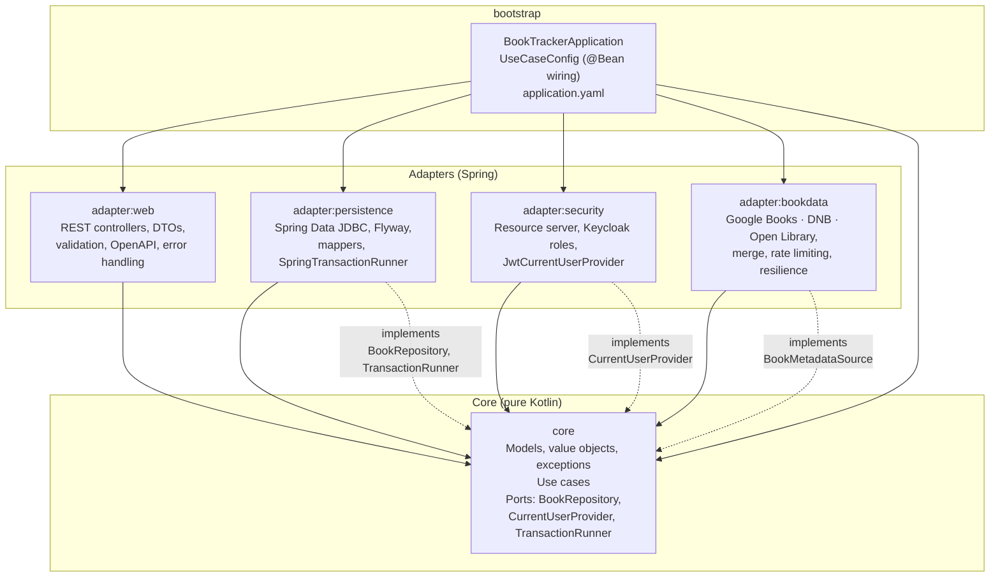
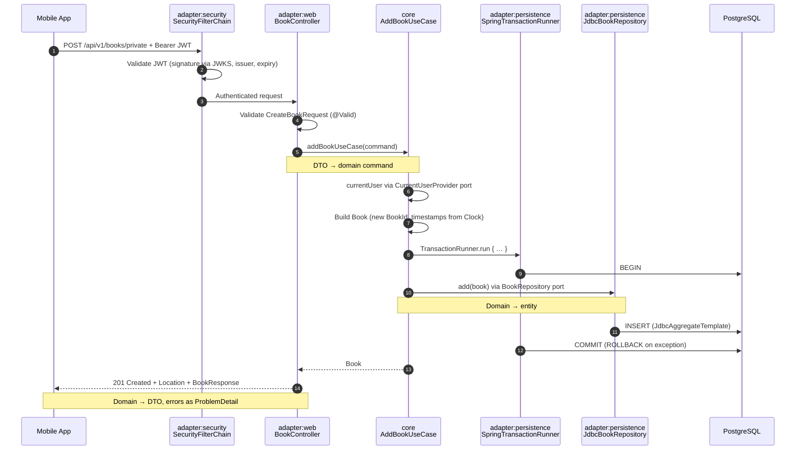

# BookTracker Backend – Architecture

## 1. Context & Goals

The BookTracker backend is a CRUD backend for the **BookTracker mobile app**. It provides a REST API, stores data in PostgreSQL and delegates authentication to a self-hosted **Keycloak**.

**Goals**
- Clear boundaries between business logic and technology, **enforced by the build**
- Little boilerplate for simple CRUD cases, with room for growing business logic
- Best-practice auth for mobile apps (OAuth2 Authorization Code + PKCE)
- Reproducible local development

**Tech stack**

| Area | Technology |
|---|---|
| Language / runtime | Kotlin 2.3, Java 25 |
| Framework | Spring Boot 4.1 (Spring MVC) |
| Build | Gradle (Kotlin DSL), multi-module, version catalog, convention plugins |
| Persistence | PostgreSQL, Spring Data JDBC, Flyway |
| Auth | Keycloak (OIDC), Spring Security OAuth2 Resource Server |
| External book data | Google Books API, DNB SRU, Open Library ([book-data.md](book-data.md)) |
| Resilience | Resilience4j (rate limiter, circuit breaker), timeouts on the JDK `HttpClient` |
| API docs | springdoc-openapi (OpenAPI 3, Swagger UI) |
| Tests | JUnit 5, kotlin-test, unit tests only |
| Local infrastructure | Docker Compose (`spring-boot-docker-compose`) |
| Deployment | Container image from Spring Boot's buildpack support, GitHub Actions, Portainer stacks for dev and prod ([deployment.md](deployment.md)) |

## 2. System Context


- The app opens the Keycloak login in the **system browser** (ASWebAuthenticationSession / Custom Tabs). The backend never sees a password.
- The backend is a **pure resource server**. It validates signature, issuer and expiry of the JWTs and reads the user ID (`sub`) and roles from them.
- Keycloak manages user accounts (registration, password reset, MFA). The backend references users only by their `sub` ID.
- Book metadata comes from public sources at request time. Only the backend talks to them, so API keys, rate limits, normalisation and caching live in one place, and the sources see the server's IP, never the user's. Cover images are the exception: the app loads them straight from the source ([ADR-004](adr/004-image-handling.md)).

## 3. Module Structure

The backend follows a **hexagonal architecture (ports & adapters)** with a **pure Kotlin core** ([ADR-001](adr/001-hexagonal-architecture.md), [ADR-005](adr/005-pure-kotlin-core.md)). Each part is its own Gradle module. Within the modules, code is split **by feature** (`book`, `shelf`, …).



Solid arrows are Gradle dependencies. Dashed arrows show which adapter implements which port. All dependencies point **inwards**: the core knows no adapter, and adapters don't know each other.

### 3.1 Modules at a Glance

| Module | Responsibility | May depend on | Key dependencies |
|---|---|---|---|
| `core` | Domain models, business rules, use cases, all ports (repositories, `CurrentUserProvider`, `TransactionRunner`), domain exceptions | – | Kotlin stdlib only (**no Spring**) |
| `:adapter:web` | HTTP API: controllers, request/response DTOs, validation, OpenAPI, errors → ProblemDetail | `core` | `starter-webmvc`, `jackson-module-kotlin` (Jackson 3), `starter-validation`, `springdoc-openapi-starter-webmvc-ui` |
| `:adapter:persistence` | Implementation of the repository ports and `TransactionRunner`, DB entities, migrations | `core` | `starter-data-jdbc`, `starter-flyway`, `flyway-database-postgresql`, `postgresql` (runtime) |
| `:adapter:security` | `SecurityFilterChain`, JWT → roles, `CurrentUserProvider` | `core` | `starter-security-oauth2-resource-server` |
| `:adapter:bookdata` | One client per public book source, provider registration, field-level merge, rate limiting and circuit breaking ([book-data.md](book-data.md)) | `core` | `spring-web` (`RestClient`), `resilience4j-ratelimiter`/`-circuitbreaker`/`-micrometer`, `jackson-module-kotlin`, `micrometer-core` |
| `bootstrap` | Assembly: main class, use case wiring, configuration | all | `spring-boot-starter`, `starter-actuator`, `spring-boot-docker-compose` (dev only) |

### 3.2 Architecture Rules

1. **Only `implementation(project(...))`, never `api(...)`.** Dependencies do not leak transitively, e.g. `:adapter:web` cannot import persistence classes. Violations are **compile errors**.
2. **`core` is framework-free.** No Spring, JDBC or Jackson in `core`, not even annotations. The build enforces this: `core` has no Spring on its classpath.
3. **Ports live in `core`, implementations in the adapters.** This covers repositories and technical ports like `CurrentUserProvider` and `TransactionRunner`.
4. **Separate models per layer.** Mappers (Kotlin extension functions) translate web DTOs ↔ domain model ↔ persistence entity. API contract, domain model and DB schema can change independently.
5. **One class per use case, no interface in front.** E.g. `AddBookUseCase`, `UpdateProgressUseCase`. Tests fake the ports, not the use cases. Add an interface only once there are several implementations.
6. **Controllers only talk to use cases**, never directly to ports. Every use case enforces visibility itself, so nobody can skip the check: a user may change only their own rows, and may read their own plus the public ones (`owner_id IS NULL`).
7. **Transactions via the `TransactionRunner` port.** Use cases wrap their work in `tx.run { … }`. The implementation in `:adapter:persistence` uses Spring's `TransactionTemplate`. No `@Transactional` in `core` or on controllers.
8. **Use cases are wired in `bootstrap`.** `UseCaseConfig` registers each use case as a `@Bean`. Adapters use regular Spring stereotypes (`@RestController`, `@Component`, …).
9. **Logic starts in the use case.** A rule moves into the domain model once it is clearly a business rule (e.g. "progress must not exceed the page count"). Until then, models may stay plain `data class`es.
10. **No security knowledge in the web adapter.** The `CurrentUserProvider` port provides the current user, not `@AuthenticationPrincipal`.

## 4. Request Flow

Example: `POST /api/v1/books/private` (create a private book). `WebConfig` adds the `/api/v1` prefix to the project's own `@RestController`s. springdoc's endpoints are excluded by package and stay at the root.

The transaction step is *(planned)*.



## 5. Package Convention

Packages follow the pattern `com.sauerwein.booktracker.<module>.<feature>` (e.g. `core.book`, `adapter.web.book`). The main class lives in `com.sauerwein.booktracker`, so component scanning and JDBC repository scanning cover all modules.

Inside a feature package, code is grouped into sub-packages:

- `core`: `models`, `usecases` and, where a feature has its own errors, `exception` (e.g. `core.book.models`).
- `:adapter:web`: `dtos` (e.g. `adapter.web.book.dtos`).
- Ports stay directly in the feature package (`core.book.BookRepository`), and **only ports** do. Plain data such as `SourceDescriptor` is a model. Logic built on the ports is a use case, also when only other use cases call it (`ResolveIsbnUseCase`, `StoreCatalogEntryUseCase`).
- Cross-feature code lives in `shared` (core) or `common` (adapters), grouped by concern (`config`, `exception`).

```
backend/
├─ build-logic/                 # Convention plugins
├─ gradle/libs.versions.toml    # Central versions
├─ core/                        # core.book, core.user, core.shared
├─ adapter/
│  ├─ web/                      # book, catalog, common (config, exception)
│  ├─ persistence/              # book, common; Flyway migrations in resources/db/migration
│  ├─ security/                 # SecurityConfig, KeycloakRoleConverter, JwtCurrentUserProvider
│  └─ bookdata/                 # composite + merge, googlebooks, dnb, openlibrary, resilience
├─ bootstrap/                   # BookTrackerApplication, config/UseCaseConfig, application.yaml
├─ compose.yaml                 # Local dev: Postgres + Keycloak
├─ keycloak/                    # Realm import for local development (with test users)
└─ deploy/                      # Server deployment, see docs/deployment.md
```

Wiring a use case in `bootstrap`:

```kotlin
@Configuration
class UseCaseConfig {
    @Bean
    fun clock(): Clock = Clock.systemUTC()

    @Bean
    fun addBookUseCase(bookRepository: BookRepository, clock: Clock) = AddBookUseCase(
        bookRepository = bookRepository,
        clock = clock
    )
}
```

Ports like `CurrentUserProvider` and `TransactionRunner` are passed in the same way.

## 6. Build Setup

- `settings.gradle.kts` includes `build-logic` via `includeBuild` and registers all modules. Adapters are nested under `adapter/` (`include("adapter:web")` → project `:adapter:web`). The parent `:adapter` is an empty grouping project. The foojay resolver provisions the Java toolchain.
- `gradle.properties` holds `group`/`version` and enables parallel builds, the build cache and the configuration cache.
- Versions live only in `gradle/libs.versions.toml`. The Spring Boot BOM is a Gradle platform. The `io.spring.dependency-management` plugin is not used.

| Plugin | Contents | Used by |
|---|---|---|
| `booktracker.kotlin-library` | Kotlin JVM, Java toolchain from the catalog, compiler args (`-Xjsr305=strict`, `-Xannotation-default-target=param-property`), Kotlin BOM, JUnit Platform | `core` |
| `booktracker.spring-library` | + `kotlin-spring`, Spring Boot BOM as `platform(...)`, `kotlin-reflect` | adapters |
| `booktracker.spring-boot-app` | + Spring Boot plugin (executable jar, `bootRun`) | `bootstrap` |

## 7. Cross-Cutting Concerns

### Security
- Stateless, no session, CSRF disabled (pure token API).
- Public: `/actuator/health/**` and `/actuator/info` (version and commit, which the deploy workflow waits for). Everything else needs a valid JWT, including `/actuator/metrics`. Only `health`, `info` and `metrics` are exposed.
- Swagger UI and `/v3/api-docs` have their own filter chain. They are open when `booktracker.api-docs.password` is empty (local) and use HTTP Basic against that one user otherwise (deployed environments). That password only opens the pages. API calls still need a token.
- `issuer-uri`: `http://localhost:8180/realms/booktracker` (local), overridable via `BOOKTRACKER_ISSUER_URI`. JWKS keys are loaded on the first token and cached. Deployed, the keys come from Keycloak inside Docker (`jwk-set-uri`), while the issuer is still checked against the public URL.
- The issuer URL must be a **stable DNS name** per environment. It is part of every token (`iss`), of the client's redirect URIs and of the Swagger UI configuration. Changing it later invalidates all issued tokens.
- Roles: Keycloak claim `realm_access.roles` → Spring authorities `ROLE_<name>`.
- Keycloak client `booktracker-app`: public client, standard flow + PKCE (S256), redirect URI via app scheme.

### Validation & Error Handling
- Bean Validation on request DTOs (`@field:NotBlank`, `@field:Positive`, …) and `@Valid` in the controller. Failed fields come back in an `errors` list (`field`, `code`, `message`). Clients branch on `code`, since Hibernate Validator localizes `message`. The server locale is fixed to `en`.
- The domain model checks business invariants itself. Invalid input throws `ValidationException` (`field`, `code`) and becomes a 400 in the same shape as a Bean Validation error. `require(...)` is for real invariants: a violation is a bug and ends as a 500.
- Two `@RestControllerAdvice`s translate errors into **ProblemDetail (RFC 9457)**. `GlobalExceptionHandler` has the highest precedence, ahead of Spring Boot's `ProblemDetailsExceptionHandler` (`@Order(0)`). `FallbackExceptionHandler` has the lowest, so its catch-all doesn't shadow the specific handlers.

| Error | HTTP status |
|---|---|
| Validation error | 400 |
| `NotFoundException` | 404 |
| Conflict / duplicate | 409 |
| `SourceUnavailableException` (book source down, throttled or circuit open) | 503, `code: SourceUnavailable`, fixed detail without the source's name (it is logged instead) |
| Unexpected error | 500 (without internal details) |

### API Documentation
- springdoc generates `/v3/api-docs` and the Swagger UI. An OAuth2 security scheme against Keycloak lets the Swagger UI send authenticated requests.
- The OpenAPI spec can be the basis for client generation in the mobile app.

### Database & Migrations
- Flyway is the **only** way the schema changes (`adapter/persistence/src/main/resources/db/migration`). No automatic schema generation.
- Naming scheme: `V<n>__<description>.sql`. Never modify a migration that has been applied.
- Ownership via a nullable `owner_id` column (Keycloak `sub`, UUID): set means private to that user, `NULL` means a public catalog entry ([ADR-006](adr/006-catalog-and-private-books.md)). There is no user table and no foreign key.
- Because of that missing foreign key, Keycloak's user store is as critical as this database. If a realm is recreated, every `sub` changes and every row is orphaned. A production Keycloak needs its own persistent database and backups.
- A row is one edition ([ADR-008](adr/008-edition-as-catalog-unit.md)). Catalog columns and rules (provenance, licence allowlist, `review_state`, language) are in [book-data.md](book-data.md#4-catalog-storage).

### Images
- Only book covers from the external sources. The backend stores the `cover_url`. The app loads the image from that URL, so the backend neither stores nor serves image files ([ADR-004](adr/004-image-handling.md)).
- If the cover is missing or unreachable, the app shows a placeholder.

### Tests

**Unit tests only**: no Spring context, no database or HTTP mock server, no containers in `./gradlew build`.

| What | Module | Tools |
|---|---|---|
| Use cases and domain rules | `core` | JUnit 5, kotlin-test, fakes for ports (incl. a `TransactionRunner` that just runs the block) |
| Mappers and decorators | `:adapter:bookdata` | plain objects and fakes, e.g. the stub source behind `ResilientBookMetadataSource`. **No live network calls in `./gradlew build`**: a test loop would burn a daily budget |

SQL, migrations, constraints, redirects and wiring need a real database or HTTP exchange. Check them by hand, against the dev stack or a throwaway copy of the dev database.

## 8. Further Docs

- [book-data.md](book-data.md): external book sources, merge, catalog, rate limits
- [adr/](adr/README.md): architecture decision records
- [deployment.md](deployment.md): dev and prod environments
- [mvp-features.md](mvp-features.md): MVP scope
