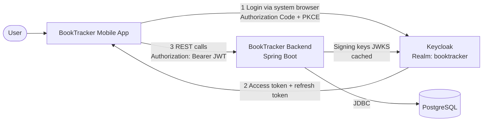
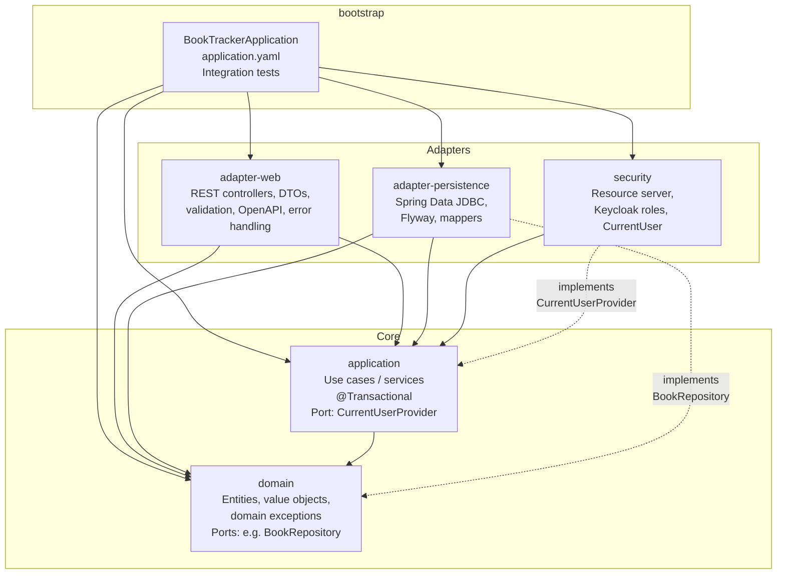
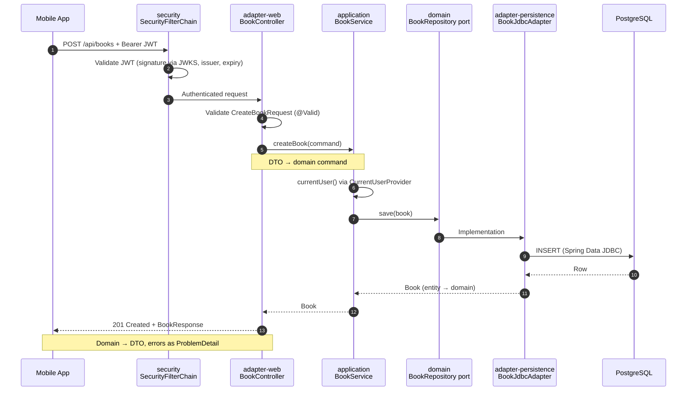

# BookTracker Backend – Architecture

> Status: Draft · Last updated: 2026-09-19

## 1. Context & Goals

The BookTracker backend is a classic CRUD backend for the **BookTracker mobile app**. It provides a REST API, stores data in PostgreSQL and delegates authentication to a self-hosted **Keycloak**.

**Goals**
- Clear boundaries between business logic and technology, **enforced by the build**
- Little boilerplate for simple CRUD cases, while leaving room for growing business logic
- Best-practice auth for mobile apps (OAuth2 Authorization Code + PKCE)
- Reproducible local development and tests against real infrastructure

**Tech stack**

| Area | Technology |
|---|---|
| Language / runtime | Kotlin 2.3, Java 25 |
| Framework | Spring Boot 4.1 (Spring MVC) |
| Build | Gradle (Kotlin DSL), multi-module, version catalog, convention plugins |
| Persistence | PostgreSQL, Spring Data JDBC, Flyway |
| Auth | Keycloak (OIDC), Spring Security OAuth2 Resource Server |
| API docs | springdoc-openapi (OpenAPI 3, Swagger UI) |
| Tests | JUnit 5, Spring Boot Test, Testcontainers (Postgres, Keycloak) |
| Local infrastructure | Docker Compose (`spring-boot-docker-compose`) |

## 2. System Context



- The app opens the Keycloak login in the **system browser** (ASWebAuthenticationSession / Custom Tabs). The backend never sees a password.
- The backend is a **pure resource server**: it validates signature, issuer and expiry of the JWTs and reads the user ID (`sub`) and roles from them.
- User accounts (registration, password reset, MFA) are managed by Keycloak. The backend references users exclusively by their `sub` ID.

## 3. Module Structure

The backend follows a **hexagonal architecture (ports & adapters)**. Each layer is its own Gradle module; within the modules, code is split **by feature** (`book`, `shelf`, …).



Solid arrows are Gradle dependencies; dashed arrows show which adapter implements which port. All dependencies point **inwards**: the core knows no adapter.

### 3.1 Modules at a Glance

| Module | Responsibility | May depend on | Key dependencies |
|---|---|---|---|
| `domain` | Domain model, business rules, outbound ports, domain exceptions | – | Kotlin stdlib only (**no Spring**) |
| `application` | Orchestrate use cases, transaction boundaries, cross-cutting ports | `domain` | `spring-context`, `spring-tx` |
| `adapter-web` | HTTP API: controllers, request/response DTOs, validation, OpenAPI, errors → ProblemDetail | `application`, `domain` | `starter-webmvc`, `starter-validation`, `springdoc-openapi-starter-webmvc-ui`, `jackson-module-kotlin` |
| `adapter-persistence` | Implementation of the repository ports, DB entities, migrations | `application`, `domain` | `starter-data-jdbc`, `flyway-core`, `flyway-database-postgresql`, `postgresql` (runtime) |
| `security` | `SecurityFilterChain`, JWT → roles, `CurrentUserProvider` | `application` | `starter-oauth2-resource-server` |
| `bootstrap` | Assembly: main class, configuration, end-to-end tests | all | `starter-actuator`, `spring-boot-docker-compose`, Testcontainers |

### 3.2 Architecture Rules

1. **Only `implementation(project(...))`, never `api(...)`.** Dependencies do not leak transitively, e.g. `adapter-web` cannot import persistence classes. Violations are **compile errors**.
2. **`domain` is framework-free.** No Spring, JDBC or Jackson annotations in the domain model.
3. **Ports live inside, implementations outside.** Repository interfaces in `domain`, technical cross-cutting ports (e.g. `CurrentUserProvider`) in `application`.
4. **Separate models per layer.** Web DTOs ↔ domain model ↔ persistence entity are translated via mappers (Kotlin extension functions). This keeps the API contract, domain model and DB schema independently changeable.
5. **Pragmatism for inbound ports.** Controllers call application services directly. Dedicated use-case interfaces are only introduced once there are multiple callers or implementations.
6. **Transactions only in `application`.** `@Transactional` belongs on use-case methods, not on controllers or repositories.
7. **No security knowledge in the web adapter.** The current user is provided by the `CurrentUserProvider` port, not by `@AuthenticationPrincipal`.

## 4. Request Flow

Example: `POST /api/books` (create a book)



## 5. Package Convention & Example Feature

Packages follow the pattern `com.sauerwein.booktracker.<module>.<feature>`. The main class lives in `com.sauerwein.booktracker` so that component scanning and JDBC repository scanning cover all modules.

```
backend/
├─ build-logic/                               # Convention plugins
├─ gradle/libs.versions.toml                  # Central versions
├─ domain/src/main/kotlin/com/sauerwein/booktracker/domain/
│  ├─ common/NotFoundException.kt
│  └─ book/
│     ├─ Book.kt                              # Domain model (data class)
│     ├─ BookId.kt                            # Value object
│     └─ BookRepository.kt                    # Outbound port (interface)
├─ application/src/main/kotlin/com/sauerwein/booktracker/application/
│  ├─ common/CurrentUserProvider.kt           # Port
│  └─ book/
│     ├─ BookService.kt                       # Use cases, @Transactional
│     └─ CreateBookCommand.kt
├─ adapter-web/src/main/kotlin/com/sauerwein/booktracker/adapter/web/
│  ├─ common/GlobalExceptionHandler.kt        # → ProblemDetail
│  ├─ common/OpenApiConfig.kt
│  └─ book/
│     ├─ BookController.kt
│     ├─ BookDtos.kt                          # CreateBookRequest, BookResponse
│     └─ BookWebMapper.kt
├─ adapter-persistence/src/main/
│  ├─ kotlin/com/sauerwein/booktracker/adapter/persistence/book/
│  │  ├─ BookEntity.kt                        # @Table data class
│  │  ├─ BookJdbcRepository.kt                # Spring Data CrudRepository
│  │  ├─ BookJdbcAdapter.kt                   # implements domain.BookRepository
│  │  └─ BookPersistenceMapper.kt
│  └─ resources/db/migration/V1__init.sql
├─ security/src/main/kotlin/com/sauerwein/booktracker/security/
│  ├─ SecurityConfig.kt                       # SecurityFilterChain
│  ├─ KeycloakRoleConverter.kt                # realm_access.roles → ROLE_*
│  └─ JwtCurrentUserProvider.kt
├─ bootstrap/src/
│  ├─ main/kotlin/com/sauerwein/booktracker/BookTrackerApplication.kt
│  ├─ main/resources/application.yaml
│  └─ test/kotlin/...                         # Integration tests (Testcontainers)
├─ compose.yaml                               # Postgres + Keycloak
└─ keycloak/realm-booktracker.json            # Realm import for local development
```

## 6. Build Setup

- `settings.gradle.kts` includes `build-logic` via `includeBuild` and registers all modules.
- Convention plugins in `build-logic` keep the module build scripts short:

| Plugin | Contents | Used by |
|---|---|---|
| `booktracker.kotlin-library` | Kotlin JVM, Java toolchain from the catalog, compiler args (`-Xjsr305=strict`, `-Xannotation-default-target=param-property`), JUnit Platform | `domain` |
| `booktracker.spring-library` | + `kotlin-spring`, Spring Boot BOM as `platform(...)` | `application`, adapters, `security` |
| `booktracker.spring-boot-app` | + Spring Boot plugin (executable jar, `bootRun`) | `bootstrap` |

- Versions live exclusively in `gradle/libs.versions.toml`. The Spring Boot BOM is included as a Gradle platform; the `io.spring.dependency-management` plugin is dropped.

## 7. Cross-Cutting Concerns

### Security
- Stateless, no session, CSRF disabled (pure token API).
- Public: `/actuator/health`, `/v3/api-docs/**`, `/swagger-ui/**`. Everything else requires a valid JWT.
- `issuer-uri`: `http://localhost:8180/realms/booktracker` (local). JWKS keys are loaded and cached automatically.
- Roles: Keycloak claim `realm_access.roles` → Spring authorities `ROLE_<name>`.
- Keycloak client `booktracker-app`: public client, standard flow + PKCE (S256), redirect URI via app scheme.

### Validation & Error Handling
- Bean Validation on request DTOs (`@field:NotBlank`, `@field:Size`, …) and `@Valid` in the controller.
- Business invariants are checked by the domain model itself (e.g. `require(...)` in the `init` block).
- A global `@RestControllerAdvice` translates errors consistently into **ProblemDetail (RFC 9457)**:

| Error | HTTP status |
|---|---|
| Validation error | 400 |
| `NotFoundException` | 404 |
| Conflict / duplicate | 409 |
| Unexpected error | 500 (without internal details) |

### API Documentation
- springdoc generates `/v3/api-docs` and the Swagger UI. An OAuth2 security scheme against Keycloak is configured so the Swagger UI can send authenticated requests.
- The OpenAPI spec can serve as the basis for client generation in the mobile app.

### Database & Migrations
- The schema is managed **exclusively via Flyway** (`adapter-persistence/src/main/resources/db/migration`), no automatic schema generation.
- Naming scheme: `V<n>__<description>.sql`. Migrations that have already been applied are never modified.
- User ownership via an `owner_id` column (Keycloak `sub`, UUID), no user table with passwords.

### Images
- MVP: only book covers from the external book API. The backend stores just the `cover_url` on the book. The app loads the image directly from the external source; the backend neither stores nor serves image files.
- If the cover is missing or unreachable, the app shows a placeholder.
- Own uploads are out of scope for the MVP; the intended approach is described in ADR-004.

### Tests

| Level | Module | Tools |
|---|---|---|
| Unit tests for business logic | `domain`, `application` | JUnit 5, kotlin-test, fakes for ports |
| Web slice | `adapter-web` | `@WebMvcTest`, mocked services |
| Persistence slice | `adapter-persistence` | `@DataJdbcTest` + Testcontainers Postgres |
| End-to-end | `bootstrap` | `@SpringBootTest` + Testcontainers (Postgres, Keycloak) |

## 8. Architecture Decision Records (ADRs)

### ADR-001: Hexagonal architecture with Gradle modules

- **Context:** Package conventions alone tend to erode over time. Boundaries should be enforced technically.
- **Decision:** Ports & adapters, one layer per Gradle module, packages per feature within the modules.
- **Consequences:**
  - ➕ Boundary violations are compile errors; `domain` stays testable without Spring.
  - ➕ Technologies (DB, auth) are replaceable within their adapter.
  - ➖ More mapping code (DTO ↔ domain ↔ entity) and more build configuration.
  - ➖ A single feature is spread across several modules.

### ADR-002: Spring Data JDBC as persistence technology

- **Context:** We were looking for the persistence solution that fits Kotlin and a CRUD backend best.
- **Decision:** Spring Data JDBC with Flyway.

| | Spring Data JDBC ✅ | Exposed | jOOQ |
|---|---|---|---|
| License | Apache 2.0 | Apache 2.0 | Open Source Edition free for Postgres |
| Queries | Generated repos + SQL strings in `@Query` | Kotlin DSL, type-safe | SQL DSL, most type-safe, generated from the real schema |
| Schema source | Flyway, mapping by convention | Flyway + hand-written table objects (duplicated) | Flyway, codegen reads the schema |
| Postgres features (CTE, window, upsert, JSONB) | native SQL only | partial | full |
| Effort for simple CRUD | very low | medium | medium |
| Build complexity | low | low | higher (codegen with Docker in the build) |
| Spring integration | first-class | starter | official starter |

- **Consequences:**
  - ➕ Immutable Kotlin `data class`es, no lazy-loading or session issues, very little code for CRUD.
  - ➖ Aggregate model: references between aggregates by ID only. Complex queries as SQL strings.
  - ↪ If things become query-heavy, `adapter-persistence` can be switched to jOOQ partially or entirely without touching `domain` or `application`.

### ADR-003: Keycloak as identity provider

- **Context:** The mobile app needs best-practice login and registration without an external SaaS service.
- **Decision:** Self-hosted Keycloak; the backend is a pure OAuth2 resource server.

| | Custom JWT issuing | Spring Authorization Server | Keycloak ✅ |
|---|---|---|---|
| Cost | – | free (Apache 2.0) | free (Apache 2.0, CNCF), separate container |
| Mobile best practice (Code + PKCE) | ❌ equivalent to the password grant, removed in OAuth 2.1 | ✅ | ✅ |
| Login/registration pages, password reset, email verification | build yourself | build yourself | included |
| MFA, passkeys, social login, admin UI | build yourself | build yourself | included |
| Operations | nothing extra | embedded in the backend | separate service (~0.5–1 GB RAM, own DB) |
| User data | own DB | own DB | in Keycloak, referenced via `sub` |
| Modules in the backend | `security` + login endpoints | `auth-server` + `security` | `security` only |

- **Consequences:**
  - ➕ Standards-compliant OIDC flow, comprehensive user management without custom code, lean backend.
  - ➕ Switching to another IdP only changes the `issuer-uri` in the backend.
  - ➖ An additional service to operate and update. Login pages must be customized via a Keycloak theme.
  - ➖ User-related data in the backend references an external ID (`sub`).

### ADR-004: Image handling

- **Context:** Possible image types are book covers from the external book API, custom cover photos taken by users, and profile pictures. The MVP only needs covers from the scan lookup.
- **Decision (MVP):** Only covers from the external API, stored as a URL (hotlinking). No own image storage, no uploads.
- **Consequences:**
  - ➕ No storage infrastructure, no upload code, nothing to secure or clean up.
  - ➖ Depends on availability and rate limits of the external API; cover URLs may change or disappear.
  - ↪ Switching to stored copies of external covers is possible later without API changes (the book keeps a cover URL).

**Future direction (once users can upload images):**

- **Storage:** S3-compatible object storage (e.g. AWS S3, Cloudflare R2, Hetzner Object Storage; locally an S3 emulator container). Never in Postgres (`bytea`) or on the local file system. The database only holds metadata: key, content type, size, owner.
- **Architecture:** port `ImageStorage` in `application`, new module `adapter-storage` (S3 client).
- **Upload:**

| | Multipart via backend (start here) | Presigned URL (direct to storage) |
|---|---|---|
| Flow | App → `POST /api/.../cover` → backend validates → storage | App requests upload URL → uploads directly → confirms to backend |
| Validation | fully in the backend | only afterwards (size limit can be encoded in the URL) |
| Backend load | yes | no |
| Complexity | low | higher (two steps, possible orphaned uploads) |

- **Delivery:** presigned GET URLs, or a public bucket / CDN with immutable, unguessable keys. A new upload always gets a new key, so clients can cache forever (`Cache-Control: immutable`).
- **Checklist:**
  - Check the file type by magic bytes, not by `Content-Type` or file extension
  - Enforce a size limit (`spring.servlet.multipart.max-file-size`)
  - App converts HEIC to JPEG/WebP and downscales (e.g. max. 1200 px) before uploading
  - Backend re-encodes images: strips EXIF data incl. GPS location and neutralizes crafted files; generate thumbnails at the same time
  - Upload to storage first, then write the DB row; a periodic cleanup job removes orphaned files
  - Delete images when a book is removed and when an account is deleted (GDPR)
  - Upload quota per user to prevent abuse

## 9. Local Development

| Service | Port | Purpose |
|---|---|---|
| Backend | 8080 | REST API, Swagger UI at `/swagger-ui.html` |
| PostgreSQL | 5432 | App database |
| Keycloak | 8180 | IdP, admin console, realm `booktracker` (imported from `keycloak/realm-booktracker.json`) |

`./gradlew :bootstrap:bootRun` automatically starts the services from `compose.yaml` via `spring-boot-docker-compose`.

## 10. Next Steps

Detailed implementation plan with checklists: `docs/roadmap.md` (local only, not versioned)

1. Implement the skeleton: `build-logic`, create modules, move the existing `src/` into `bootstrap`
2. Add `compose.yaml` and the Keycloak realm export
3. Basic configuration for security, error handling and OpenAPI
4. First feature `book` as reference implementation through all layers
5. Optional: architecture tests (e.g. Konsist) for rules within a module
