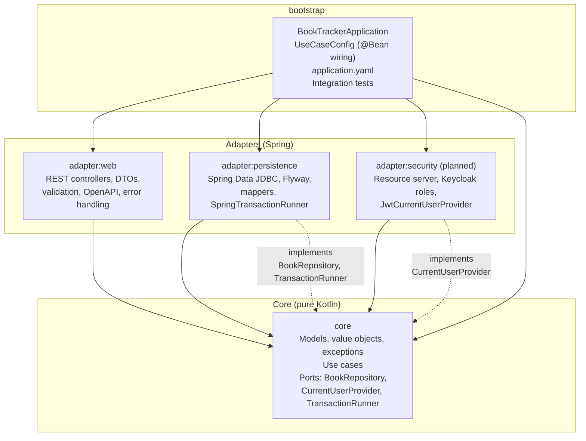
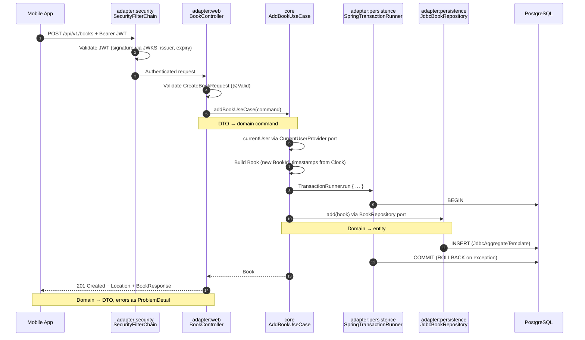

# BookTracker Backend – Architecture

> Status: Draft · Last updated: 2026-09-20

## 1. Context & Goals

The BookTracker backend is a classic CRUD backend for the **BookTracker mobile app**. It provides a REST API, stores data in PostgreSQL and delegates authentication to a self-hosted **Keycloak**.

**Goals**
- Clear boundaries between business logic and technology, **enforced by the build**
- Little boilerplate for simple CRUD cases, while leaving room for growing business logic
- Best-practice auth for mobile apps (OAuth2 Authorization Code + PKCE)
- Reproducible local development and tests against real infrastructure

**Tech stack**

| Area | Technology |
|---|---|
| Language / runtime | Kotlin 2.3, Java 25 |
| Framework | Spring Boot 4.1 (Spring MVC) |
| Build | Gradle (Kotlin DSL), multi-module, version catalog, convention plugins |
| Persistence | PostgreSQL, Spring Data JDBC, Flyway |
| Auth | Keycloak (OIDC), Spring Security OAuth2 Resource Server |
| API docs | springdoc-openapi (OpenAPI 3, Swagger UI) |
| Tests | JUnit 5, Spring Boot Test, Testcontainers (Postgres, Keycloak) |
| Local infrastructure | Docker Compose (`spring-boot-docker-compose`) |

## 2. System Context


- The app opens the Keycloak login in the **system browser** (ASWebAuthenticationSession / Custom Tabs). The backend never sees a password.
- The backend is a **pure resource server**: it validates signature, issuer and expiry of the JWTs and reads the user ID (`sub`) and roles from them.
- User accounts (registration, password reset, MFA) are managed by Keycloak. The backend references users exclusively by their `sub` ID.

## 3. Module Structure

The backend follows a **hexagonal architecture (ports & adapters)** with a **pure Kotlin core**. Each part is its own Gradle module; within the modules, code is split **by feature** (`book`, `shelf`, …).



Solid arrows are Gradle dependencies; dashed arrows show which adapter implements which port. All dependencies point **inwards**: the core knows no adapter, and adapters don't know each other.

### 3.1 Modules at a Glance

| Module | Responsibility | May depend on | Key dependencies |
|---|---|---|---|
| `core` | Domain models, business rules, use cases, all ports (repositories, `CurrentUserProvider`, `TransactionRunner`), domain exceptions | – | Kotlin stdlib only (**no Spring**) |
| `:adapter:web` | HTTP API: controllers, request/response DTOs, validation, OpenAPI, errors → ProblemDetail | `core` | `starter-webmvc`, `jackson-module-kotlin` (Jackson 3), `starter-validation`, `springdoc-openapi-starter-webmvc-ui` |
| `:adapter:persistence` | Implementation of the repository ports and `TransactionRunner`, DB entities, migrations | `core` | `starter-data-jdbc`, `starter-flyway`, `flyway-database-postgresql`, `postgresql` (runtime) |
| `:adapter:security` | `SecurityFilterChain`, JWT → roles, `CurrentUserProvider` (planned, added with auth) | `core` | `starter-oauth2-resource-server` |
| `bootstrap` | Assembly: main class, use case wiring, configuration, end-to-end tests | all | `spring-boot-starter`, `spring-boot-docker-compose` (dev only), Testcontainers; planned: `starter-actuator` |

### 3.2 Architecture Rules

1. **Only `implementation(project(...))`, never `api(...)`.** Dependencies do not leak transitively, e.g. `:adapter:web` cannot import persistence classes. Violations are **compile errors**.
2. **`core` is framework-free.** No Spring, JDBC or Jackson in `core`, not even annotations. Enforced by the build: `core` has no Spring on its classpath.
3. **Ports live in `core`, implementations in the adapters.** This covers repositories as well as technical ports like `CurrentUserProvider` and `TransactionRunner`.
4. **Separate models per layer.** Web DTOs ↔ domain model ↔ persistence entity are translated via mappers (Kotlin extension functions). This keeps the API contract, domain model and DB schema independently changeable.
5. **One class per use case, no interface in front.** E.g. `AddBookUseCase`, `UpdateProgressUseCase`. Tests fake the ports, not the use cases. An interface is only introduced once there are multiple implementations.
6. **Controllers only talk to use cases**, never directly to ports. Every use case enforces visibility itself, so the check cannot be skipped: a user may change only their own rows, and may read their own plus the public ones (`owner_id IS NULL`).
7. **Transactions via the `TransactionRunner` port.** Use cases wrap their work in `tx.run { … }`; the implementation in `:adapter:persistence` uses Spring's `TransactionTemplate`. No `@Transactional` in `core` or on controllers.
8. **Use cases are wired in `bootstrap`.** `UseCaseConfig` registers each use case as a `@Bean`. Adapters use regular Spring stereotypes (`@RestController`, `@Component`, …).
9. **Logic starts in the use case.** A rule moves into the domain model once it is clearly a business rule (e.g. "progress must not exceed the page count"). Models may stay plain `data class`es until then.
10. **No security knowledge in the web adapter.** The current user is provided by the `CurrentUserProvider` port, not by `@AuthenticationPrincipal`.

## 4. Request Flow

Example: `POST /api/v1/books` (create a book). `WebConfig` adds the `/api/v1` prefix to the project's own `@RestController`s; springdoc's endpoints are excluded by package and stay at the root.

The security, `@Valid`, current-user and transaction steps are part of the target design and not implemented yet.



## 5. Package Convention & Example Feature

Packages follow the pattern `com.sauerwein.booktracker.<module>.<feature>` (e.g. `core.book`, `adapter.web.book`). The main class lives in `com.sauerwein.booktracker` so that component scanning and JDBC repository scanning cover all modules.

Within a feature package, the code is grouped further into sub-packages: `models` and `usecases` in `core` (e.g. `core.book.models`, `core.book.usecases`), `dtos` in `:adapter:web` (e.g. `adapter.web.book.dtos`). Ports stay directly in the feature package (`core.book.BookRepository`). Cross-feature code lives in `shared` (core) or `common` (adapters), grouped by concern (`config`, `exception`).

Files marked *(planned)* don't exist yet.

```
backend/
├─ build-logic/                               # Convention plugins
├─ gradle/libs.versions.toml                  # Central versions
├─ core/src/main/kotlin/com/sauerwein/booktracker/core/
│  ├─ shared/
│  │  ├─ CurrentUserProvider.kt               # Port (planned)
│  │  ├─ TransactionRunner.kt                 # Port (planned)
│  │  ├─ UserId.kt                            # Value object, Keycloak sub (planned)
│  │  └─ exception/NotFoundException.kt
│  └─ book/
│     ├─ BookRepository.kt                    # Outbound port (interface)
│     ├─ models/
│     │  ├─ Book.kt                           # Domain model + BookId value object
│     │  └─ Isbn.kt                           # Value object, always a valid ISBN-13
│     └─ usecases/
│        ├─ AddBookUseCase.kt                 # Use case + AddBookCommand
│        ├─ GetBookUseCase.kt
│        └─ GetBooksUseCase.kt
├─ adapter/web/src/main/kotlin/com/sauerwein/booktracker/adapter/web/
│  ├─ common/
│  │  ├─ config/
│  │  │  ├─ WebConfig.kt                      # /api/v1 prefix for own @RestControllers
│  │  │  └─ OpenApiConfig.kt                  # OpenAPI title and version
│  │  └─ exception/
│  │     ├─ GlobalExceptionHandler.kt         # expected errors → ProblemDetail
│  │     ├─ FallbackExceptionHandler.kt       # anything unhandled → 500, logged
│  │     └─ ValidationError.kt                # field, code, message per failed field
│  └─ book/
│     ├─ BookController.kt
│     ├─ BookWebMapper.kt
│     └─ dtos/
│        ├─ CreateBookRequest.kt
│        └─ BookResponse.kt
├─ adapter/persistence/src/main/
│  ├─ kotlin/com/sauerwein/booktracker/adapter/persistence/
│  │  ├─ common/SpringTransactionRunner.kt    # implements core TransactionRunner (planned)
│  │  └─ book/
│  │     ├─ BookEntity.kt                     # @Table data class
│  │     ├─ BookDao.kt                        # Spring Data ListCrudRepository
│  │     ├─ JdbcBookRepository.kt             # implements core BookRepository
│  │     └─ BookPersistenceMapper.kt
│  └─ resources/db/migration/
│     ├─ V1__init.sql
│     └─ V2__book.sql
├─ adapter/security/src/main/kotlin/com/sauerwein/booktracker/adapter/security/   # (planned)
│  ├─ SecurityConfig.kt                       # SecurityFilterChain
│  ├─ KeycloakRoleConverter.kt                # realm_access.roles → ROLE_*
│  └─ JwtCurrentUserProvider.kt
├─ bootstrap/src/
│  ├─ main/kotlin/com/sauerwein/booktracker/
│  │  ├─ BookTrackerApplication.kt
│  │  └─ config/UseCaseConfig.kt              # @Bean per use case, Clock bean
│  ├─ main/resources/application.yaml
│  └─ test/kotlin/...                         # Integration tests (Testcontainers)
├─ compose.yaml                               # Local dev: Postgres (Keycloak planned)
├─ compose.prod.yaml                          # Production: app + Postgres
└─ keycloak/realm-booktracker.json            # Realm import for local development (planned)
```

Wiring a use case in `bootstrap`:

```kotlin
@Configuration
class UseCaseConfig {
    @Bean
    fun clock(): Clock = Clock.systemUTC()

    @Bean
    fun addBookUseCase(bookRepository: BookRepository, clock: Clock) = AddBookUseCase(
        bookRepository = bookRepository,
        clock = clock
    )
}
```

Once they exist, `CurrentUserProvider` and `TransactionRunner` are passed in the same way.

## 6. Build Setup

- `settings.gradle.kts` includes `build-logic` via `includeBuild` and registers all modules. Adapters are nested under `adapter/` (`include("adapter:web")` → project `:adapter:web` in `adapter/web/`); the parent `:adapter` is an empty grouping project without a build script. The foojay resolver provisions the Java toolchain automatically.
- `gradle.properties` holds `group`/`version` for all projects and enables parallel builds, the build cache and the configuration cache.
- Convention plugins in `build-logic` keep the module build scripts short:

| Plugin | Contents | Used by |
|---|---|---|
| `booktracker.kotlin-library` | Kotlin JVM, Java toolchain from the catalog, compiler args (`-Xjsr305=strict`, `-Xannotation-default-target=param-property`), Kotlin BOM, JUnit Platform | `core` |
| `booktracker.spring-library` | + `kotlin-spring`, Spring Boot BOM as `platform(...)`, `kotlin-reflect` | adapters |
| `booktracker.spring-boot-app` | + Spring Boot plugin (executable jar, `bootRun`) | `bootstrap` |

- Versions live exclusively in `gradle/libs.versions.toml`. The Spring Boot BOM is included as a Gradle platform; the `io.spring.dependency-management` plugin is dropped.

## 7. Cross-Cutting Concerns

### Security
- Stateless, no session, CSRF disabled (pure token API).
- Public: `/actuator/health`, `/v3/api-docs/**`, `/swagger-ui/**`. Everything else requires a valid JWT.
- `issuer-uri`: `http://localhost:8180/realms/booktracker` (local). JWKS keys are loaded and cached automatically.
- Roles: Keycloak claim `realm_access.roles` → Spring authorities `ROLE_<name>`.
- Keycloak client `booktracker-app`: public client, standard flow + PKCE (S256), redirect URI via app scheme.

### Validation & Error Handling
- Bean Validation on request DTOs (`@field:NotBlank`, `@field:Positive`, …) and `@Valid` in the controller. Failed fields are returned in an `errors` list (`field`, `code`, `message`); clients branch on `code`, since `message` is localized by Hibernate Validator. The server locale is fixed to `en` so messages don't depend on the machine.
- Business invariants are checked by the domain model itself (e.g. `require(...)` in the `init` block of `Book`, `Isbn.of(...)`). For now, the resulting `IllegalArgumentException` is mapped to 400; domain-specific exceptions are to replace this.
- Two `@RestControllerAdvice`s translate errors consistently into **ProblemDetail (RFC 9457)**: `GlobalExceptionHandler` with the highest precedence (ahead of Spring Boot's own `ProblemDetailsExceptionHandler`, which is registered with `@Order(0)`), and `FallbackExceptionHandler` with the lowest, so a catch-all doesn't shadow the more specific handlers.

| Error | HTTP status |
|---|---|
| Validation error | 400 |
| `NotFoundException` | 404 |
| Conflict / duplicate | 409 |
| Unexpected error | 500 (without internal details) |

### API Documentation
- springdoc generates `/v3/api-docs` and the Swagger UI. An OAuth2 security scheme against Keycloak is configured so the Swagger UI can send authenticated requests.
- The OpenAPI spec can serve as the basis for client generation in the mobile app.

### Database & Migrations
- The schema is managed **exclusively via Flyway** (`adapter/persistence/src/main/resources/db/migration`), no automatic schema generation.
- Naming scheme: `V<n>__<description>.sql`. Migrations that have already been applied are never modified.
- User ownership via a nullable `owner_id` column (Keycloak `sub`, UUID): set means private to that user, `NULL` means a public catalog entry. No user table with passwords (planned; `V2__book.sql` has no `owner_id` yet).

### Images
- MVP: only book covers from the external book API. The backend stores just the `cover_url` on the book. The app loads the image directly from the external source; the backend neither stores nor serves image files.
- If the cover is missing or unreachable, the app shows a placeholder.
- Own uploads are out of scope for the MVP; the intended approach is described in ADR-004.

### Tests

| Level | Module | Tools |
|---|---|---|
| Unit tests for use cases and domain rules | `core` | JUnit 5, kotlin-test, fakes for ports (incl. a `TransactionRunner` that just runs the block), no Spring |
| Web slice | `:adapter:web` | `@WebMvcTest`, mocked use cases |
| Persistence slice | `:adapter:persistence` | `@DataJdbcTest` + Testcontainers Postgres |
| End-to-end | `bootstrap` | `@SpringBootTest` + Testcontainers (Postgres, Keycloak) |

## 8. Architecture Decision Records (ADRs)

### ADR-001: Hexagonal architecture with Gradle modules

- **Context:** Package conventions alone tend to erode over time. Boundaries should be enforced technically.
- **Decision:** Ports & adapters: a pure core plus one Gradle module per adapter, packages per feature within the modules. The shape of the core is refined in ADR-005.
- **Consequences:**
  - ➕ Boundary violations are compile errors; `core` stays testable without Spring.
  - ➕ Technologies (DB, auth) are replaceable within their adapter.
  - ➖ More mapping code (DTO ↔ domain ↔ entity) and more build configuration.
  - ➖ A single feature is spread across several modules.

### ADR-002: Spring Data JDBC as persistence technology

- **Context:** We were looking for the persistence solution that fits Kotlin and a CRUD backend best.
- **Decision:** Spring Data JDBC with Flyway.

| | Spring Data JDBC ✅ | Exposed | jOOQ |
|---|---|---|---|
| License | Apache 2.0 | Apache 2.0 | Open Source Edition free for Postgres |
| Queries | Generated repos + SQL strings in `@Query` | Kotlin DSL, type-safe | SQL DSL, most type-safe, generated from the real schema |
| Schema source | Flyway, mapping by convention | Flyway + hand-written table objects (duplicated) | Flyway, codegen reads the schema |
| Postgres features (CTE, window, upsert, JSONB) | native SQL only | partial | full |
| Effort for simple CRUD | very low | medium | medium |
| Build complexity | low | low | higher (codegen with Docker in the build) |
| Spring integration | first-class | starter | official starter |

- **Consequences:**
  - ➕ Immutable Kotlin `data class`es, no lazy-loading or session issues, very little code for CRUD.
  - ➖ Aggregate model: references between aggregates by ID only. Complex queries as SQL strings.
  - ↪ If things become query-heavy, `:adapter:persistence` can be switched to jOOQ partially or entirely without touching `core`.

### ADR-003: Keycloak as identity provider

- **Context:** The mobile app needs best-practice login and registration without an external SaaS service.
- **Decision:** Self-hosted Keycloak; the backend is a pure OAuth2 resource server.

| | Custom JWT issuing | Spring Authorization Server | Keycloak ✅ |
|---|---|---|---|
| Cost | – | free (Apache 2.0) | free (Apache 2.0, CNCF), separate container |
| Mobile best practice (Code + PKCE) | ❌ equivalent to the password grant, removed in OAuth 2.1 | ✅ | ✅ |
| Login/registration pages, password reset, email verification | build yourself | build yourself | included |
| MFA, passkeys, social login, admin UI | build yourself | build yourself | included |
| Operations | nothing extra | embedded in the backend | separate service (~0.5–1 GB RAM, own DB) |
| User data | own DB | own DB | in Keycloak, referenced via `sub` |
| Modules in the backend | `:adapter:security` + login endpoints | `auth-server` + `:adapter:security` | `:adapter:security` only |

- **Consequences:**
  - ➕ Standards-compliant OIDC flow, comprehensive user management without custom code, lean backend.
  - ➕ Switching to another IdP only changes the `issuer-uri` in the backend.
  - ➖ An additional service to operate and update. Login pages must be customized via a Keycloak theme.
  - ➖ User-related data in the backend references an external ID (`sub`).

### ADR-004: Image handling

- **Context:** Possible image types are book covers from the external book API, custom cover photos taken by users, and profile pictures. The MVP only needs covers from the scan lookup.
- **Decision (MVP):** Only covers from the external API, stored as a URL (hotlinking). No own image storage, no uploads.
- **Consequences:**
  - ➕ No storage infrastructure, no upload code, nothing to secure or clean up.
  - ➖ Depends on availability and rate limits of the external API; cover URLs may change or disappear.
  - ↪ Switching to stored copies of external covers is possible later without API changes (the book keeps a cover URL).

**Future direction (once users can upload images):**

- **Storage:** S3-compatible object storage (e.g. AWS S3, Cloudflare R2, Hetzner Object Storage; locally an S3 emulator container). Never in Postgres (`bytea`) or on the local file system. The database only holds metadata: key, content type, size, owner.
- **Architecture:** port `ImageStorage` in `core`, new module `:adapter:storage` (S3 client).
- **Upload:**

| | Multipart via backend (start here) | Presigned URL (direct to storage) |
|---|---|---|
| Flow | App → `POST /api/.../cover` → backend validates → storage | App requests upload URL → uploads directly → confirms to backend |
| Validation | fully in the backend | only afterwards (size limit can be encoded in the URL) |
| Backend load | yes | no |
| Complexity | low | higher (two steps, possible orphaned uploads) |

- **Delivery:** presigned GET URLs, or a public bucket / CDN with immutable, unguessable keys. A new upload always gets a new key, so clients can cache forever (`Cache-Control: immutable`).
- **Checklist:**
  - Check the file type by magic bytes, not by `Content-Type` or file extension
  - Enforce a size limit (`spring.servlet.multipart.max-file-size`)
  - App converts HEIC to JPEG/WebP and downscales (e.g. max. 1200 px) before uploading
  - Backend re-encodes images: strips EXIF data incl. GPS location and neutralizes crafted files; generate thumbnails at the same time
  - Upload to storage first, then write the DB row; a periodic cleanup job removes orphaned files
  - Delete images when a book is removed and when an account is deleted (GDPR)
  - Upload quota per user to prevent abuse

### ADR-005: Pure Kotlin core containing the use cases

- **Context:** The first draft split the core into `domain` (entities, ports, no Spring) and `application` (use cases with `@Service`/`@Transactional`). For a CRUD-heavy app, `domain` would have stayed nearly empty, while the logic worth testing (ownership, scan flow, shelf rules) would have lived in a module with Spring on its classpath.
- **Decision:** One module `core` holds domain models, ports **and** use cases, in pure Kotlin. Use cases are plain classes wired as `@Bean`s in `bootstrap`. Transactions go through a `TransactionRunner` port implemented with `TransactionTemplate` in `:adapter:persistence`.

| | Single module, feature packages | `domain` + `application` (Spring) | Pure `core` ✅ |
|---|---|---|---|
| Boundaries enforced by | code review only | build | build |
| Where the testable logic lives | mixed with Spring code | module with Spring | Spring-free module |
| Nearly empty module | – | `domain` | – |
| Extra wiring | none | none | one `@Bean` per use case, `TransactionRunner` port |

- **Consequences:**
  - ➕ Use cases and rules are unit-tested in milliseconds with fakes, without Spring context or database.
  - ➕ The whole core is framework-free, enforced by the compiler; no proxy pitfalls (self-invocation, `open` classes) in the core.
  - ➖ One `@Bean` method per use case and an explicit `tx.run { … }` instead of an annotation.
  - ➖ Still more structure than a pure CRUD app strictly needs (mapping code between layers).
  - ↪ If a rich domain emerges later, `core` can be split into `domain` and `application` again.

### ADR-006: Public catalog and private books in one table

- **Context:** `book` currently conflates two things: objective facts about a book (title, author, ISBN, cover) and a user's personal relationship to it. The target is a centrally maintained catalog — curated by an admin or imported from public book databases — that every user can see, plus books a user creates when the catalog does not have them, visible only to their creator.
- **Decision:** One `book` table with a **nullable** `owner_id`: `NULL` is a public catalog entry, a set value makes the row private to that user. The visibility rule `owner_id IS NULL OR owner_id = :me` lives behind the `BookRepository` port: no read method may return another user's private row, so every one of them is either scoped to the caller or restricted to `owner_id IS NULL`. An unscoped `findAll()` does not exist. Catalog rows have no owner and must not be given the curating admin's `sub`. A user's relationship to a book (reading status, possession, favourite) is a separate per-user row referencing the book, with independent axes instead of one `status` field, because owning, having read and favouring a book are not mutually exclusive.

| | One `book`, nullable `owner_id` ✅ | `book` + `custom_book` |
|---|---|---|
| Foreign key from the per-user row | one column | polymorphic: two nullable columns plus `CHECK` |
| Reading catalog and private books | one query | merge two sources |
| Publishing a private book | `UPDATE … SET owner_id = NULL` | copy row, rewrite references |
| Visibility enforced by | the port | `NOT NULL` in the schema |

- **Consequences:**
  - ➕ One id space and one mapper; the per-user row needs no polymorphic foreign key.
  - ➕ A private book can become a catalog entry without touching anything that references it.
  - ➖ Visibility is guaranteed by the port, not by the schema — an unscoped read method would silently leak private books, so none may exist.
  - ➖ "The same ISBN only once" becomes two partial unique indexes, one for `owner_id IS NULL` (per ISBN) and one for `owner_id IS NOT NULL` (per owner and ISBN), both restricted to `isbn IS NOT NULL`. A plain `UNIQUE (owner_id, isbn)` misses duplicate public entries, and `NULLS NOT DISTINCT` would additionally allow a user only a single book without an ISBN.
  - ↪ Should private books ever need their own fields, they can move into a separate table later; only the per-user row's foreign key has to follow.

## 9. Local Development

| Service | Port | Purpose |
|---|---|---|
| Backend | 8080 | REST API under `/api/v1`, Swagger UI at `/swagger-ui.html` (planned) |
| PostgreSQL | 5432 | App database |
| Keycloak | 8180 | IdP, admin console, realm `booktracker` (imported from `keycloak/realm-booktracker.json`) (planned) |

`./gradlew :bootstrap:bootRun` automatically starts the services from `compose.yaml` via `spring-boot-docker-compose`.

## 10. Next Steps

Detailed implementation plan with checklists: `docs/roadmap.md` (local only, not versioned)

1. ✅ Implement the skeleton: create the modules `core`, `:adapter:web`, `:adapter:persistence`, `bootstrap`; move the existing `src/` into `bootstrap`
2. Add `compose.yaml` (✅ Postgres) and the Keycloak realm export
3. Basic configuration for security, error handling (✅ validation and ProblemDetail) and OpenAPI (✅ springdoc)
4. First feature `book` as reference implementation through all layers (✅ create, get one, get all; without auth and transactions)
5. Optional: architecture tests (e.g. Konsist) for rules within a module
