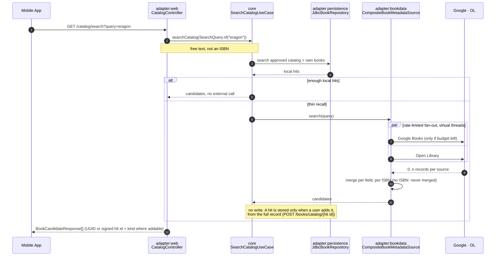

# BookTracker Backend – Book Data & Catalog

Book metadata comes from three public sources at request time, behind the single port `BookMetadataSource` ([ADR-007](adr/007-book-data-from-public-sources.md)). `:adapter:bookdata` holds one client per source plus the merge and all resilience. `core` and the app see one normalised `BookCandidate` shape. Books that users look up are stored in the public catalog, so most lookups never leave the backend.

## 1. Sources and Their Roles

**Google finds the book. DNB and Open Library describe the one we keep.** Recall and field accuracy are different qualities. Google's free-text matching survives typos and partial titles, but its field data comes largely from scans and publisher feeds, so page counts and dates are weak. A national library record describes a specific physical edition.

| | Free-text search | ISBN lookup | Covers | Licence |
|---|---|---|---|---|
| **Google Books** | ✅ excellent | not used | ✅ | restrictive, **never stored** |
| **DNB** | ❌ no relevance ranking | ✅ complete and authoritative for German imprints | ❌ none | CC0 |
| **Open Library** | usable | ⚠ edition-dependent | ✅ larger images | CC0 |

Decisions:

- **Google is search-only and its data is never stored, not even in a private book.** The Google APIs Terms of Service forbid permanent copies of API content. Its descriptor declares `supportsIsbnLookup = false`. So the scan flow, the MVP's most important path, uses none of the 1,000/day budget, and a Google lookup could not pre-fill a form anyway. Flipping the flag is one value in the descriptor.
- **DNB is never a search provider.** SRU rejects `sortKeys`, so results come back newest-first, never by relevance. Its descriptor declares `supportsFreeTextSearch = false`. It is a lookup and field authority.
- **ISBN lookup asks every ISBN provider, in parallel, and merges what they know.** A barcode scan yields the ISBN of one specific printing, and the sources index different printings. A single-source lookup fails often. The decisive axis is the edition, not the language: Open Library carries German editions, just not every printing.
- **DNB leads German-language editions.** Legal deposit means it receives essentially every German-language printing. This is a field precedence keyed by the book's language (`de`), not by ISBN group.
- **For every other language DNB comes last.** It also holds translations of German works and books from foreign publishers. As the last entry it only fills gaps, and answers alone where nobody else knows the ISBN.
- Free-text search: Google first, then Open Library, DNB not at all.

## 2. Merge

`BookCandidateMerge` merges **field by field**, as **first non-null wins over a configured order**. No single source reliably has everything. It only merges records of **one edition**: the ISBN lookup's answers for the scanned ISBN, or search hits with the same ISBN-13. Hits without an ISBN are never merged, and editions of one work stay apart ([ADR-008](adr/008-edition-as-catalog-unit.md)).

| Field | Order (language `de`) | Order (every other language, or unknown) |
|---|---|---|
| title, authors, publisher, year, pageCount, work key | `dnb` → `google_books` → `open_library` | `google_books` → `open_library` → `dnb` |
| coverUrl | `google_books` → `open_library` | `open_library` → `google_books` |
| language (decided first, the same for every book) | `dnb` → `open_library` → `google_books` | as before |
| ISBN | the one asked for, or shared by the merged hits | as before |

Google does no ISBN lookup and DNB no search, so a scan merges DNB and Open Library, and a search merges Google and Open Library.

- **The language is decided first**, over its own list, because the order of every other field depends on it. Each mapper reads it from its source (Google `language`, Open Library `languages` / `editions.language`, never the work-level list, which names every translation; DNB `041$a`, else `008/35-37`). `Language` normalises it.
- **Authors are one field.** The first non-empty list wins whole. Two lists are never combined, or the same person spelled twice would appear twice. With no list anywhere, the book has no author.
- **Authors taken from a work rank last.** Open Library's fallback list (see [quirks](#open-library)) is used only when no other provider has a record of the edition, even one without authors. A work may credit translators and editors of an anonymous text (the Nibelungenlied, `9783150006443`). Accepted cost: where DNB lacks an author by a cataloguing gap, the correct work author loses too, and the row has no author.
- **The record is named after the provider whose title it carries.** Its `source` and `source_id` become the row's identity. Other providers only fill fields.
- **A merged record is only as storable as its least storable contribution.** It may enter the catalog only if every record that supplied a field may. Google data cannot ride into a stored row under a CC0 provider's identity.
- A provider that returns no record contributes nothing, so the next one in the order wins. No rule asks who answered.
- A provider record without an author is a record like any other. It contributes its fields, and alone it is a found book.
- ⚠ **A provider that fails during a scan shortens the stored record for good.** The catalog answers that ISBN from then on, and a stored row is never refreshed by a lookup. Our own throttle does the same under load: a request that waits longer than 5 s for a permit counts as failed, so a burst of scans stores the later ones without Open Library's fields. The other side: a full row can never be made shorter.
- A record listing several ISBNs (an Open Library edition, hardcover and paperback) stores only the first one. A scan of the other ISBN misses the catalog and asks the sources again each time.

## 3. Pluggable Providers

Providers can be added, removed and reordered without touching the orchestration. Three properties make that true. The first alone only makes *adding* cheap.

1. **Each provider declares itself.** A `SourceDescriptor` (in `core`, so the licence rule stays unit-testable) carries the stable `id`, what the provider can do (ISBN lookup, free-text search, covers), its scope (language, publisher), and whether its licence permits storing records in the public catalog. `CompositeBookMetadataSource` skips providers that cannot serve a query instead of knowing each source's quirks.
2. **Order, precedence and enablement are configuration.** One uniform block per provider. Adding one is filling in a block, reordering is a restart:

```yaml
booktracker.bookdata:
  order:
    search: [google_books, open_library]           # the order search hits are listed in
  precedence:                                      # which value wins a field (MergePrecedence)
    language: [dnb, open_library, google_books]
    default:  { fields: [google_books, open_library, dnb], cover: [open_library, google_books] }
    by-language:
      de:     { fields: [dnb, google_books, open_library], cover: [google_books, open_library] }
  open-library: { enabled: true, base-url: https://openlibrary.org, rate-per-second: 1, connect-timeout: 5s, read-timeout: 10s }
  google-books: { enabled: true, base-url: https://www.googleapis.com, api-key: …, country: DE }
  dnb:          { enabled: true, base-url: https://services.dnb.de, rate-per-second: 1, read-timeout: 3s }
```

   A field's order is looked up as: the language's own list for that field, the language's `fields`, then the same two in `default`. Per-field lists exist for `title`, `authors`, `publisher`, `publication-year`, `page-count`, `cover` and `work-key`. Providers not listed come last, by id. A language key that is not a language fails startup. An id that matches no running provider logs a warning. The precedence never decides which providers are asked: every provider that can serve the query is.

3. **Wiring is a list of beans.** Each provider's config registers a `BookSourceRegistration`, and the composite collects them. The composite is the only `BookMetadataSource` bean, with no `@Primary`. `@ConditionalOnProperty` makes `enabled: false` a real removal, so a provider returning garbage can be switched off in production without a deploy. Resilience4j instances and Micrometer tags are named after the provider id, so limits, circuit breakers and metrics come with the block.

Removing a provider is `enabled: false`, deleting its package, and dropping it from the precedence lists. It needs no data migration: existing rows keep `source = 'dnb'` and stay valid. Adding a search-only provider needs no migration either. Only promoting one to the public catalog does.

**This is not a plugin system.** No SPI, no dynamic loading, no registry service. Three to five providers in one codebase is a list of beans and a config block.

What stays manual:

- One mapper per provider. JSON, MARC21-XML and whatever the next one speaks are different.
- **A licence review per provider.** It cannot be inferred from a response. The allowlist makes forgetting it fail loudly.
- The field order is empirical. Config makes changing it cheap, but only looking at records tells you what it should be.
- Fusing relevance-ranked results degrades as providers multiply. Fine with 2–4 sources and ISBN dedupe, a ranking problem of its own at eight.

## 4. Catalog Storage

Catalog rows are `book` rows with `owner_id IS NULL` ([ADR-006](adr/006-catalog-and-private-books.md)).

- **Provenance** (`V4__book_source.sql`): `source`, `source_id` (that system's own key: a DNB IDN like `1055026991`, an Open Library edition key like `OL7353617M`), `source_fetched_at`, and `review_state`. A unique index on `(source, source_id) WHERE owner_id IS NULL` keeps the catalog free of duplicates when two users resolve the same book. ISBN alone cannot do that, since some records carry none.
- **`source` is an open vocabulary, not a closed enum**: plain `TEXT` with no constraint on the values. Provider ids are lowercase, stable and never renamed (`manual`, `dnb`, `open_library`, `google_books`, …). The data outlives the providers: a row from DNB stays `source = 'dnb'` years after the client might be deleted. Which providers are *active* is configuration, not schema.
- ⚠ **`SourceId` must stay a value class and never become an enum.** An enum would close the vocabulary again: a new provider would need a code change, and a retired one could not keep its rows. `SourceId.of` validates the *format* (`[a-z0-9_]+`), not membership. `SourceRecordId` holds the provider's own key.
- **Only data we may store enters the public catalog, written as an allowlist** so it fails closed:
  ```sql
  CHECK (owner_id IS NOT NULL OR source IN ('manual', 'dnb', 'open_library'))
  ```
  A denylist (`source <> 'google_books'`) states the same rule but fails open: add a provider, forget the rule, and its records flow into a table every user reads. With the allowlist, the same oversight rejects the first insert. A new provider is search-only until it is deliberately promoted, and promoting it takes a migration. The authority is the provider's `SourceDescriptor`, checked in the use case. The `CHECK` is the backstop.
- **`review_state`**: catalog reads filter `review_state = 'APPROVED'`, although everything is inserted as `APPROVED` today. Storing a record inserts it or, if it is already stored, returns the approved row as it is (`ON CONFLICT … DO NOTHING`, then an approved-only read). A record held by a non-approved row is neither returned by id nor linked to anyone. A review workflow later is then a changed default plus an admin endpoint, not an audit of every read path. The name is not `status`, to avoid confusion with the user's relationship to a book.
- **A stored row is never refreshed by a lookup.** A scan or an add never overwrites a review decision or a fuller earlier merge. A deliberate refresh is a separate, later feature.
- **Language** (`V6__book_language.sql`): a BCP 47 primary language subtag (`de`, `en`; three letters only where no two-letter code exists). `Language` in `core` normalises any spelling (`ger`, `deu`, `de-AT` → `de`). `NULL` where unknown and for rows written before the column existed (no backfill). A `CHECK` pins the format, not the vocabulary.
- **A book may have no author.** Anonymous, sacred, reference and edited works have none (the Duden `9783411040186`, the Bible, anthologies). `book_author` then holds no row, for catalog and private books alike (`POST /books/private` takes `authors` as optional). DNB's editors, translators and issuing bodies are never made authors. Cost: a lookup that misses an existing author stores a row without one, and since rows are never refreshed, the gap stays.
- **Edition granularity** ([ADR-008](adr/008-edition-as-catalog-unit.md)): several rows per work are normal. A nullable `work_key` (Open Library work key where known) allows grouping later without touching rows.

**The catalog grows only from deliberate actions.** Two things write a catalog row:

1. A scan, which resolves a full record by ISBN.
2. Adding a search hit, which resolves the hit's ISBN exactly like a scan, so a row looks the same however it was added. Only if the ISBN resolves to nothing, or a provider is down during the resolution, does it fall back to the hit's own full record (`BookMetadataSource.findByRecordId`).

**Search only reads.** A GET that writes would let retries, prefetching or any script grow and rewrite the shared catalog. Search hits are also thin (no pages, often no publisher). Stored, they would block the full lookup of their ISBN for good. A Google hit enters nothing: adding it resolves its ISBN through the CC0 sources, and only their record is stored.

ISBN lookups are catalog-first and only reach the sources on a miss. Text search asks the sources only while the catalog has fewer than `booktracker.catalog.min-local-hits` matches. Popular books end up local, and external calls become the long tail.

## 5. Catalog API

**Discovery is separate from the user's books.** `GET /api/v1/books` lists the user's own books. Discovery lives under `/api/v1/catalog`, with its own latency, caching and response shape: a hit is a candidate, not yet one of the user's books.

| Endpoint | Purpose | Miss behaviour |
|---|---|---|
| `GET /api/v1/catalog/search?query=` | Free-text **or** ISBN; the backend classifies | empty list. **503** only if there are no local hits, nothing was found and a source failed |
| `GET /api/v1/catalog/isbn/{isbn}` | Scan flow, exact lookup | **404** → the app opens the manual form |
| `POST /api/v1/books/catalog/{id}` | Add catalog book `{id}` (UUID or signed hit id) to my books. A link, never a copy. A hit not stored yet is resolved by its ISBN like a scan, and only the merged CC0 record is stored | **404** for anything but an approved catalog book or a valid hit id, and for an ISBN no CC0 source knows (the app then opens an **empty** form). **409** if already added. **503** if a source is down while adding a hit |
| `POST /api/v1/books/private` | Create a private book from fields (manual entry, or a catalog book the user wants to change, copied by the app) | – |

- **Hit ids.** Every hit the app may add carries an opaque `id` and `kind: CATALOG`. The caller's own books come back as `PRIVATE`. A stored book's `id` is its UUID. A hit not stored yet gets a **signed hit id** (`h2.<payload>.<tag>`, HMAC-SHA256 over a typed payload, `CatalogHitIds`): `i:<isbn>:<source>:<record>` for a hit that may enter the catalog by itself, `i:<isbn>` for any other hit (e.g. Google, or merged with Google data). The app cannot forge or alter it. The id is signed, not encrypted: opaque, not secret.
- **Provenance never leaves the backend.** Responses carry no `source`/`sourceId`, and errors do not name a provider, so the app cannot start to depend on one.
- A hit without an id cannot be added, only copied into a private book. A hit **with** an id is never copied. Google hits without an ISBN are dropped, so every Google hit has an id.
- **Results are deduplicated by ISBN.** External hits arrive merged per ISBN. A stored catalog row hides the external hits with its ISBN. The caller's private books hide nothing. Every result carries the edition's `language`, `null` where no source knows it.
- **Adding is one of two explicit actions, never a comparison.** Users never edit catalog books. `POST /books/catalog/{id}` carries no fields, so nothing a client sends can change a row everyone reads. The server never compares fields to decide which of the two a save is, and it never takes the owner or catalog identity from the request. The same ISBN may exist several times per user, next to a catalog book with that ISBN.
- **The backend detects ISBNs, not the app.** `SearchQuery.of(raw)` in `core` returns an ISBN query or free text, so pasting an ISBN into the search box works. A 13-digit string that fails the checksum, or an EAN with a `977` prefix (an ISSN, i.e. a magazine), falls back to free text.
- `Isbn` in `core` is ISBN-13 only. ISBN-10 normalisation happens at the adapter edge.
- **Search is explicit.** The user submits a term, there is no search-as-you-type. One external round trip per catalog miss (~200–500 ms) is acceptable, and no debouncing is needed.



## 6. Rate Limits & Resilience

Rate limits shape the design more than latency does. The free tiers sit far below what a pass-through proxy would need, and the three budgets have different shapes.

| Source | Budget | Mechanism | When exhausted |
|---|---|---|---|
| Open Library | **we cap at 1 req/s**, although a contact `User-Agent` would allow 3 | token bucket, blocks and waits | a sub-second wait is invisible |
| DNB SRU | **none published**, we self-impose 1 req/s | token bucket, blocks and waits | as above |
| Google Books | **1,000 queries/day** per key, plus 100/min per user | counter, non-blocking guard | **drop Google from the fan-out** and answer from the CC0 sources |

- **Open Library stays at 1 req/s on purpose.** The limit is per IP and shared with anything behind it, and being wrong costs "aggressive rate limiting or blocking", not a clean error. With explicit search and the catalog absorbing repeats, 3 req/s buys nothing worth that risk. The contact `User-Agent` stays: the policy asks for it, and it lets them contact us instead of blocking us.
- **Google's daily budget needs a degrade path.** A per-second limiter would hang the request for hours. The 1,000/day figure comes from the Cloud Console for this project. It is ~1,000 catalog misses per day across all users: fine for private use, and the ceiling that makes the catalog essential. The 100/min per-user limit is not binding: without `quotaUser` the backend counts as one user. A pseudonymous `quotaUser` (hash of the Keycloak `sub`, never an email) does nothing for the daily cap, so it is not used.
- **Retry `503`, never `429`/quota-`403`.** Google returns transient `503 Service temporarily unavailable` often. `503` is retried with backoff (2 attempts). Quota exhaustion arrives as `429` (`Quota exceeded for ... 'Queries per day'`) or a `403` with a quota reason. Retrying those makes an exhausted budget worse.
- **The Google API key is validated at startup.** A missing or empty key fails as an ordinary `429` from a shared anonymous pool, which looks like a quota problem. So the app fails fast or does not register the provider. Key via `BOOKTRACKER_GOOGLE_BOOKS_API_KEY`, never committed.
- **`country=DE` on every Google request.** From a server IP Google cannot geolocate, the API answers `403 Cannot determine user location for geographically restricted operation`. It works from a laptop and fails from a container.
- **Timeouts and circuit breaker.** Connect 1 s, read 3 s per source. Open Library gets 5 s and 10 s, since its TLS handshake alone can take 2–7 s. A Resilience4j circuit breaker bounds how long a provider can take, so an outage degrades the result instead of hanging the request.
- **Parallel fan-out on virtual threads** (`spring.threads.virtual.enabled`). Blocking clients need no pool tuning, and the wait is the slowest provider's, not the sum.
- **No overall deadline.** The merged answer waits for every provider, because a scan's merge is stored for good, and a provider cut off by a deadline would leave the row short. A deadline for search alone, where nothing is stored, is possible later if search latency becomes a problem.
- **The catalog is the real rate limiter.** Resilience4j is a backstop against a bug or a spike. If the limiter trips regularly, fix the hit rate, not the bucket size.
- **Two layers, because one port call can be several requests.** The rate limiter is a `ClientHttpRequestInterceptor` in each source's `RestClient`, so it throttles on the wire: an Open Library ISBN lookup is 2–6 requests. Circuit breaker and metrics wrap the port (`ResilientBookMetadataSource`), since an outcome (hit, miss, error, throttled, circuit open) only means something per lookup. The timer is `bookdata.source.requests` with tags `source`, `operation`, `outcome`.
- **An outage is not a miss.** A failing source throws `SourceUnavailableException` (503), never `null`, or a timeout would send the scan flow to the manual form for a book that exists. Only the source's own failures are translated (provider exceptions, `RestClientException`, throttling, open circuit). Anything else is a bug and stays a 500.
  - The composite catches failures per source. A failing provider only shortens the answer. Only when **nothing** was found and at least one asked provider failed is the result a 503 instead of a miss. This holds for search and ISBN lookup.
  - A provider whose daily quota is spent was not asked, so it does not count as failed (`SourceQuotaExhaustedException`, outcome `quota_exhausted`, ignored by the circuit breaker). Otherwise every miss would be a 503 until midnight Pacific time.
  - A miss needs someone to have looked: if **no** provider answered cleanly, because all were skipped for their quota, nothing found is a 503 too.
  - A concurrent short-term pause never shortens the daily pause.
  - Search with local hits never fails on a source outage.
- ⚠ **Self-limiting breaks with more than one instance.** Two backends each capped at 1 req/s send 2 req/s. Scaling out needs shared state (Redis-backed buckets, e.g. Bucket4j), the same decision as a shared cache.

## 7. Usage Policies & Licences

- **Open Library**: CC0 data. The API is "not intended to serve as a bulk data backend or high-traffic commercial infrastructure" ([Open Library API docs](https://openlibrary.org/developers/api)). Heavy users should use the monthly dumps or contact `openlibrary@archive.org`. Today's use fits: a person searches, and the result is kept for that person's library. ⚠ It stops fitting once BookTracker is commercial or high-traffic. That is a policy threshold no throttling clears. Then Open Library moves to the monthly CC0 dumps or to agreed terms ([ADR-007](adr/007-book-data-from-public-sources.md), option D).
- **DNB**: title data, ZDB and GND are CC0, SRU needs no registration, and there is no restriction on commercial use. No published rate limit, so our 1 req/s is politeness. SRU is for targeted lookups. Bulk sync belongs on **OAI-PMH**, not deep SRU pagination. DNB gives no warranty on continuity or accuracy, and promises three months' notice before format changes. GND cross-concordances are CC BY 4.0 and would need attribution if we ever used them.
- **Google Books**: Google APIs Terms of Service forbid permanent copies, so nothing is stored. Commercial terms, branding and attribution need their own read before any paid offering.

## 8. Provider Quirks

### DNB (MARC21-XML)

`recordSchema=MARC21-xml`. Six fields are extracted by hand, without a MARC library.

- The display title is `245$a` + `$n` + `$p`. `$n` can be `[...]`, DNB's placeholder for "part number unknown": drop it. Newer records put the whole title into `$a`.
- Non-sorting markers wrap articles and name parts: `\x98Das\x9c Vermächtnis`, `Jascheroff, Constantin \x98von\x9c`. **Strip them**, or they render as garbage.
- **Umlauts arrive decomposed (NFD).** Compose to NFC before storing, or a stored *Vermächtnis* never equals the same word typed by a user.
- `020` repeats. `$z` is a cancelled or invalid ISBN. Read `$a` only.
- `300$a` is `733 S.` and `264$c` is `[2014]`: unwrap both to numbers.
- `100$a` is inverted (`Paolini, Christopher`): flip for display. The `$0` GND id comes along.
- `100`/`700` carry the role in `$4`: `aut` author, `trl` translator, `nrt` narrator, `ctb` contributor. Some records have no author at all. Editors and issuing bodies (`710`) are never made authors.
- **Print vs. non-print is in the coded fields**: leader/06 `a` is text, `i` audio. `007` starting with `c` and `338$b cr` mean online. `300$a` alone is not enough, and requiring `338 nc` would drop real books: many foreign print records have no `337`/`338`. Non-print records are filtered ([ADR-008](adr/008-edition-as-catalog-unit.md)).
- No cover images.
- `maximumRecords` defaults to 10 and caps at 100. Request only what is displayed. An ISBN lookup asks for 5.
- A query DNB rejects still answers `200`, with the reason in `<diagnostics>`. A miss is `200` with `numberOfRecords 0`.

### Open Library

- `/isbn/{isbn}.json` returns an **HTML error page on a miss**, not JSON. Branch on the status code.
- `/isbn/{isbn}.json` answers with a `302` to the edition (`/books/OL…M.json`), so the client follows redirects explicitly.
- An edition lists its authors **by key only**. Each name costs one more call (`/authors/{id}.json`), so at most the first two are resolved. An author that cannot be resolved is skipped.
- **Many editions name no author, but their work does.** Then the client asks the edition's first work (`/works/{id}.json`) and resolves up to two of its authors. The work uses another shape: `authors: [{"author": {"key": …}, "type": …}]`. Such a candidate is flagged `authorsFromWork`, so the merge ranks its authors last. A missing work means no author. A failing one fails the lookup. Worst case: 6 requests.
- Not handled: a work or author merged into another may answer as a redirect stub without `authors` or `name`. The book is then stored without an author.
- Search is edition-level (`fields=editions,editions.key,editions.isbn,editions.publish_year,editions.cover_i,editions.publisher,…`): `sourceId`, ISBN, title, year, cover and publisher come from the one matching edition, never the work's mixed values. A hit is addable only if it is catalog-eligible and has an edition ISBN (`isAddable`).
- Covers by ISBN need no API call: `https://covers.openlibrary.org/b/isbn/{isbn13}-L.jpg?default=false`. `default=false` is required: without it a missing cover answers `200` with a 1×1 placeholder GIF instead of a `404`.

### Google Books

- An API key is mandatory. Unauthenticated requests share a pool that is in practice exhausted.
- The `isbn:` operator is unused, but before using it:
  - A correct hit does not always carry the ISBN (library-scan records may only have `OTHER:UCSC:…`), so the match cannot be checked from the response.
  - One ISBN can return several volumes of the same edition. `pageCount: 0` means unknown.
  - The operator is case-sensitive. `ISBN:` silently becomes a free-text search and returns unrelated books. Using those for a scanned barcode would attach the wrong book.
  - Omitting the colon (`q=isbn0735619670`) is a free-text search, not an error.
  - The field operators broke globally once (Google issue `569300353`, October to November 2026). Cheap health check: `q=intitle:eragon` must return hits.
