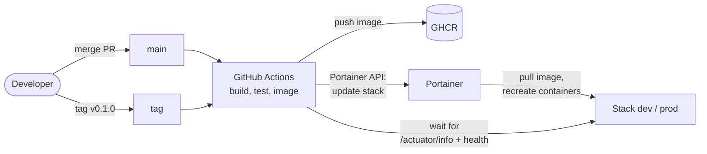

# BookTracker Backend – Deployment

> How the backend gets from a merge to a running server. This document holds the concept only: no host names, no IDs and no secrets. Real values live in the places named under [Configuration and secrets](#configuration-and-secrets).

## Overview

There are two environments, **dev** and **prod**, on one Docker host managed with Portainer. Both run the same image, built by GitHub Actions, with different configuration and data.

| | dev | prod |
|---|---|---|
| Deployed by | every push to `main` | a tag `v<major>.<minor>.<patch>` on `main` |
| Image tag | `sha-<short commit>` | the tag, e.g. `v0.1.0` |
| Keycloak realm | `booktracker-dev` | `booktracker` |
| Database | its own Postgres | its own Postgres |
| Sign-up | closed | closed (for now, see [Not covered yet](#not-covered-yet)) |

Feature branches go into `main` by pull request. There is no `develop` branch and no release branch: `main` always runs on dev, and a tag promotes that state to prod. The tag build compiles the tagged commit again (it does not reuse dev's image), and it refuses a tag whose commit is not on `main`.

## What runs on the server

| Stack | Contents | Source |
|---|---|---|
| `booktracker-keycloak` | Keycloak and its own Postgres. One server for both environments, one realm per environment | `deploy/keycloak/` |
| `booktracker-dev` | Backend and its own Postgres | `deploy/backend/compose.yaml` |
| `booktracker-prod` | Backend and its own Postgres, same compose file | `deploy/backend/compose.yaml` |

- A **reverse proxy** in front of everything ends TLS and forwards one host name per service: `api.dev.<domain>`, `api.<domain>`, `auth.<domain>`.
- The proxy, the two backends and Keycloak share the external Docker network **`booktracker-proxy`**. No container publishes a port on the host.
- The Postgres containers sit only on their own stack's network, so the proxy and the other stacks cannot reach them.
- Container names are unique across stacks (`booktracker-dev-app`, `booktracker-prod-app`, `booktracker-keycloak`), because the proxy and the backends address them by name on the shared network.
- Every container has a memory limit. The buildpack's JVM memory calculator and Keycloak size their heaps from it, not from the host's memory.

## How a deploy works

1. **Build and test**: the same job that runs on pull requests.
2. **Image**: `./gradlew :bootstrap:bootBuildImage` builds the image with Spring Boot's built-in buildpack support (Paketo, Java runtime chosen from the project's Java version). It needs no Dockerfile. The image goes to GHCR, and the commit hash goes into `/actuator/info`.
3. **Update the stack** (`deploy/portainer-deploy.sh`), using Portainer's API with an access token:
   1. Read the stack, including its variables.
   2. Change only `IMAGE_TAG`.
   3. Send the compose file of the deployed commit and all variables back, with "re-pull image" on.

   Portainer's stack update **replaces all stack variables** with the ones sent, which is why the script reads them first. The variables hold secrets, so the script never prints them or a response that contains them.
4. **Wait** up to 5 minutes until `/actuator/info` reports the deployed commit and `/actuator/health` reports `UP`. Flyway migrates the database while the new container starts.
   - If that doesn't happen, the workflow fails and GitHub reports it.
   - There is no automatic rollback, because a migration that already ran cannot be undone by starting the old image.

Two deploys to the same environment never run at the same time (`concurrency` per environment).

Keycloak has its own workflow (`.github/workflows/keycloak.yml`). Changes on `main` only build and push its image. Deploying it takes a manual **Run workflow** on `main`, because one Keycloak serves both environments.

## Keycloak

- **Image:** `deploy/keycloak/Dockerfile` extends the official image, runs `kc.sh build` (Postgres, health checks) and starts with `start --optimized`.
- **Realms:**
  - The realm files under `deploy/keycloak/realms/` are part of the image.
  - `--import-realm` creates a realm only if it doesn't exist yet, so a redeploy never resets one. Changes to an existing realm go through the admin console.
  - The realm files contain no users. Their `${…}` placeholders (the Swagger UI redirect and web origin per environment) are filled from the stack variables on import.
  - The local realm `keycloak/realm-booktracker.json` with its test users is only for `compose.yaml` on the laptop.
- **Settings for the first deployment:** no sign-up, no "forgot password" (there is no mail server yet), brute force protection on. Accounts are created in the admin console.
- **The admin console** and the master realm (`/admin/` and `/realms/master/`) ask for an extra password at the reverse proxy, before Keycloak's own login. Both paths are needed: the master realm's login endpoints alone would allow password guessing on the admin account.
- **The bootstrap admin** from the stack variables exists only for the first start. Replace it with a personal admin account that uses two-factor login, then delete it and remove its variables.
- **Token checks:** the backend checks a token's issuer against the public realm URL. It loads the signing keys inside Docker (`http://booktracker-keycloak:8080/…`) instead of through the proxy.
- **Never change the public Keycloak host name** once users exist. It is part of every token and every redirect URI.

## Swagger UI

Swagger UI and `/v3/api-docs` stay reachable on both environments, but ask for an extra password first (HTTP Basic, `BOOKTRACKER_API_DOCS_USERNAME` / `_PASSWORD`). That password only opens the pages. Calls to `/api/v1` still need a Keycloak token. Without a password set (local development) the pages are open.

## Configuration and secrets

**No secret and no host name is in git.** The repository holds variable names only.

| Where | What |
|---|---|
| Portainer, stack variables | Every server setting and secret: database credentials, issuer URL, hit-id secret, Google key, Swagger password, Keycloak bootstrap admin. Names: `deploy/backend/stack.env.example`, `deploy/keycloak/stack.env.example` |
| Portainer, registry | Read access to GHCR (a token with `read:packages`), so Portainer can pull the private images |
| GitHub, repository secret | `PORTAINER_TOKEN`: the access token of a Portainer user that may update only the BookTracker stacks |
| GitHub, repository variables | `PORTAINER_URL`, `PORTAINER_ENDPOINT_ID`, `DEV_STACK_ID`, `PROD_STACK_ID`, `KEYCLOAK_STACK_ID`, `DEV_API_URL`, `PROD_API_URL`, `AUTH_URL` |

Filled-in copies of the `*.env` files are ignored by git. Images are pushed with the workflow's own `GITHUB_TOKEN`, so no extra secret is needed for that.

## One-time setup

The order matters, because each step needs the one before it.

1. **DNS:** one record per host name, pointing at the server.
2. **Portainer:**
   - Create the network `booktracker-proxy` and connect the reverse proxy's container to it.
   - Add the GHCR registry.
   - Create a deploy user and its access token.
3. **Keycloak stack:**
   - Run the Keycloak workflow once to get an image.
   - Create the stack from `deploy/keycloak/compose.yaml` with its variables.
   - Give the deploy user access to it.
4. **Reverse proxy:** one proxy host per host name with a TLS certificate, and the extra password on the auth host's `/admin/` and `/realms/master/`.
5. **Keycloak:** a personal admin with two-factor login, remove the bootstrap admin, create the first users.
6. **Backend stacks:** create `booktracker-dev` and `booktracker-prod` from `deploy/backend/compose.yaml`, each with its own variables, and give the deploy user access.
7. **GitHub:** the secret and variables from the table above.
8. **First deploys:** merge to `main` (dev), then push the first tag (prod).

## Day to day

- **Deploy dev:** merge a pull request into `main`.
- **Release to prod:** tag a commit on `main` and push the tag (`git tag v0.2.0 && git push origin v0.2.0`).
- **Go back to an older version:** re-run the workflow of the older tag. It rebuilds and deploys that version. This works only while the database is still compatible with it: Flyway leaves newer migrations in place.
- **Change a setting or a secret:** edit the stack variable in Portainer and redeploy the stack there, or wait for the next deploy, which keeps the variables as they are.
- **Points to know when rotating:**
  - `BOOKTRACKER_CATALOG_HIT_ID_SECRET` makes search results from before the change unaddable until the app searches again.
  - A database password must be changed in Postgres too (`ALTER USER`), since the variable only sets it when the volume is first created.
  - The Portainer token is replaced in Portainer and in the GitHub secret together.

## Not covered yet

- **Backups.** Losing the server or a volume loses every account and every book. A lost Keycloak database also orphans every user's rows, because `owner_id` has no foreign key.
- **Monitoring and alerts.** An outage is only noticed in use.
- **Open sign-up.** It needs a mail server, email verification and a decision on the legal pages and account deletion.
- **More than one server.** The per-IP rate limits towards the book sources assume a single instance (see [architecture.md](architecture.md), *External Book Data*).
